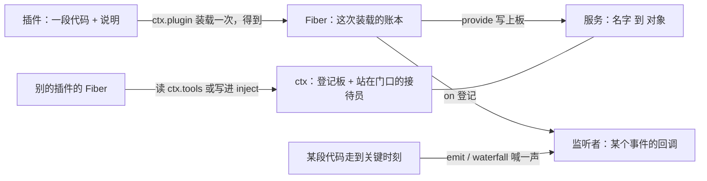
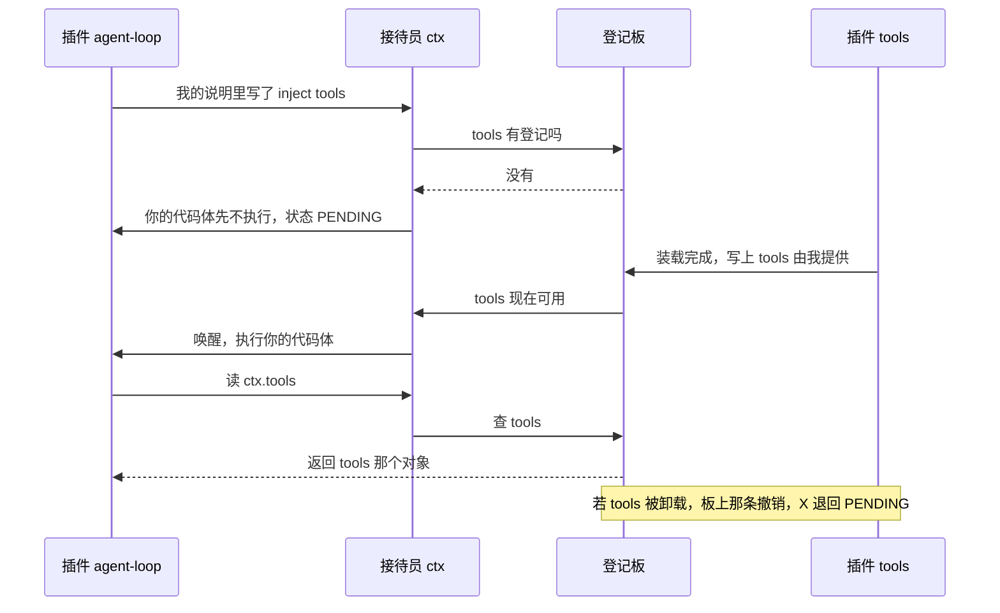
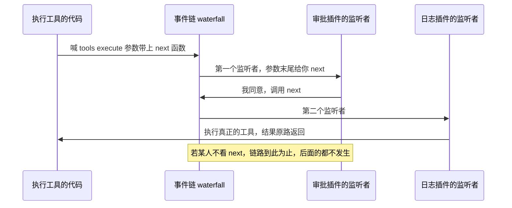

# 00 从零开始的术语表（查表用）

配套讲解在当前会话里，这份只用来查。

## A. 三种长得很像的东西怎么区分

| 长相 | 是什么 | 例子 |
|---|---|---|
| 含 `/`、以 `.ts` 结尾 | 磁盘上的一个文件（源码在哪个文件） | `vendor/cordis/src/context.ts` |
| 含 `/`、带引号、不以 `.ts` 结尾 | 一个**事件名**，斜杠只是名字里的分隔符 | `'tools/execute'` |
| 含 `.`、无 `/` | 代码：从左边那个盒子里取右边那个格子 | `ctx.tools`、`ReflectService.handler` |
| 文件后跟冒号和数字 | 那个文件的第几行 | `vendor/cordis/src/fiber.ts:147` |

本仓库讲源码时的记法：路径写成「文件 vendor/cordis/src/events.ts」，代码原样写 `ctx.on(...)`。

## B. 最底层的三个概念

| 记法 | 读作 | 含义 |
|---|---|---|
| `const 猫 = { 名字: '咪咪' }` | 造一个盒子 | 盒子 = 对象；`名字` = 格子的标签（属性）；`'咪咪'` = 格子里的值 |
| `猫.名字` | 从猫这个盒子取名字叫名字的格子 | 得到 `'咪咪'`。这叫属性访问 |
| `猫.叫()` | 取出来的东西是函数，并且执行它 | 格子里放函数时，那个函数叫方法 |

点号左边 = 去哪儿找，右边 = 找什么。带括号 = 执行，不带 = 只是取出来。

## C. 术语表

| 术语 | 一句话定义 | 在代码里的长相 |
|---|---|---|
| ctx | context 的缩写，一个变量名，指向框架唯一的"接待台"对象 | 函数体的第一个参数 `function (ctx) { ... }` |
| 服务 service | 登记板上的一条"名字 → 能干这活的对象"，别人可以报名字要它 | 提供侧 `new Service(ctx, 'tools')`；使用侧 `ctx.tools` |
| 插件 plugin | 一段能力代码 + 随身的说明（名字、配置、需求清单） | `function (ctx, config) { ... }` 或一个 class |
| fiber | **一次装载**的记账条：这条线一断，它挂出去的东西全收回 | `ctx.plugin(P)` 的返回值；状态见 `FiberState` |
| 事件 event | 一次广播或一次问询："某事发生了/即将发生，有意见的说" | 登记 `ctx.on('tools/execute', fn)`；触发 `ctx.emit(...)` |
| inject 声明 | 事先写下"我需要哪些服务名"，用来决定我什么时候被执行 | `inject: ['tools']` |
| provide 提供 | 把自己的对象写上登记板，并让人知道自己走了 | `ctx.provide('llm', adapter)` |
| effect | 一次注册动作 + 它的撤销方法，成对记账 | `ctx.effect(() => { ...; return 撤销函数 })` |
| 抛出 / throw | 当场中断并把原因交给上层接住 | `throw new Error('...')`，上层 `try { } catch { }` |
| await | 等一件还没出结果的事出结果 | `await ctx.plugin(P)` = 等它装载完成 |
| 回调 callback | 你写好交给框架、由框架在合适时机替你调用的函数 | `ctx.on('x', 回调)` 里的第二个参数 |

## D. 迷你框架（30 行，真跑过的输出）

```js
const 登记板 = new Map();   // 服务名 → 对象
const 等待唤醒 = new Map(); // 服务名 → 挂起的代码
const 监听表 = new Map();   // 事件名 → 回调列表

function 提供(name, value) { /* 写板 + 叫醒挂起的 */ }
function 需要(name, 干活的函数) { /* 有则立刻执行，无则挂起 */ }
function 听(事件名, 函数) { /* 加进列表 */ }
function 喊(事件名, 资料) { /* 依次调用列表里的函数 */ }
```

实跑输出（`node -e`，本仓库验证过）：

```
第 1 幕  agent-loop 说要 tools，但此刻还没人提供
  [需要] tools 还没有 → 不执行，把代码挂起来等
第 2 幕  tools 插件上线，把自己的能力写上板
  [提供] 登记板写上 tools
  [唤醒] tools 出现了，此刻才去执行之前挂起的代码
      agent-loop 拿到了 tools，开始注册工具
第 3 幕  两个插件登记：我要听 tools/execute 这件事
  [听] 登记：事件 tools/execute 上多了一个人
第 4 幕  真发生一次工具调用，有人喊了这一声
  [喊] tools/execute → 有 2 个人在听这件事
      守卫看到 读文件 a.txt → 决定放行
      日志看到 读文件 a.txt → 记一笔
第 5 幕  问一个板上没有的名字
      抛错 → 取 no-such-name：板上没有，事先也没打过申请单
```

## E. mini 与 Cordis 的对应

| 迷你框架 | Cordis 真名 | 文件 |
|---|---|---|
| 登记板 | `ReflectService` 里的属性表与实现表 | 文件 `vendor/cordis/src/reflect.ts` |
| `需要(name, fn)` | `inject: ['tools']` 声明 + `ctx.tools` 读取 | 文件 `vendor/cordis/src/registry.ts`、`reflect.ts` |
| `提供(name, value)` | `new Service(ctx, name)` / `ctx.provide(name, value)` | 文件 `vendor/cordis/src/service.ts`、`reflect.ts` |
| 挂起与唤醒 | `FiberState.PENDING → ACTIVE` | 文件 `vendor/cordis/src/fiber.ts:147` |
| `听(事件, fn)` | `ctx.on('tools/execute', fn)` | 文件 `vendor/cordis/src/events.ts:288` |
| `喊(事件, 资料)` | `ctx.emit(...)` / `ctx.waterfall(...)` 等五种之一 | 文件 `vendor/cordis/src/events.ts:183-243` |
| （迷你版没有）撤销账本 | `ctx.effect` 收集 disposer，fiber 卸载时逆序执行 | 文件 `vendor/cordis/src/fiber.ts:415` |

## F. 关系与流程







## G. 比喻，以及比喻在哪里失效

接待台 / 登记板用来记"名字 → 能力"。失效处：

1. 真实登记板会**按问话人所在的作用域**给出不同答案（`isolate`），前台不会。
2. 真实登记板的每一条都自带**撤销**（fiber 卸载就擦掉），前台的登记是持久的。
3. 真实"喊一声"有五种规矩（`emit` / `parallel` / `serial` / `bail` / `waterfall`），差别在等不等、有没有返回值、谁能否决，见 `vendor/cordis/src/events.ts:183-243`。
