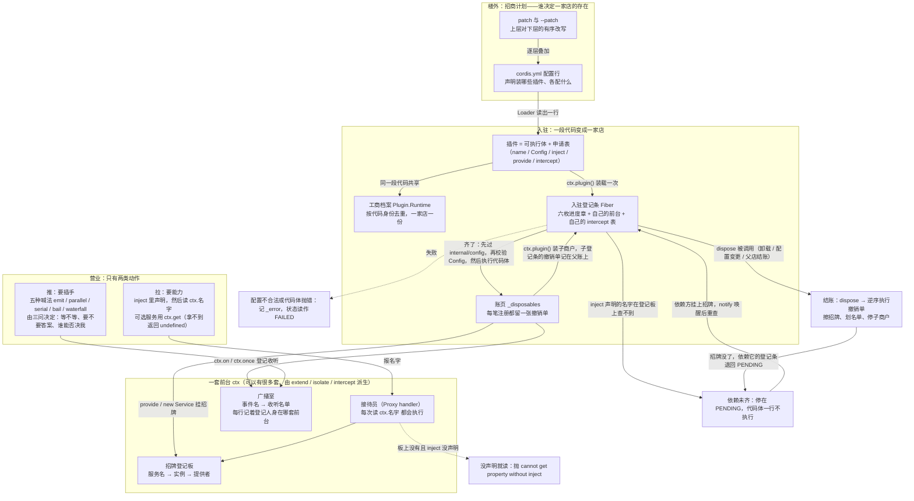
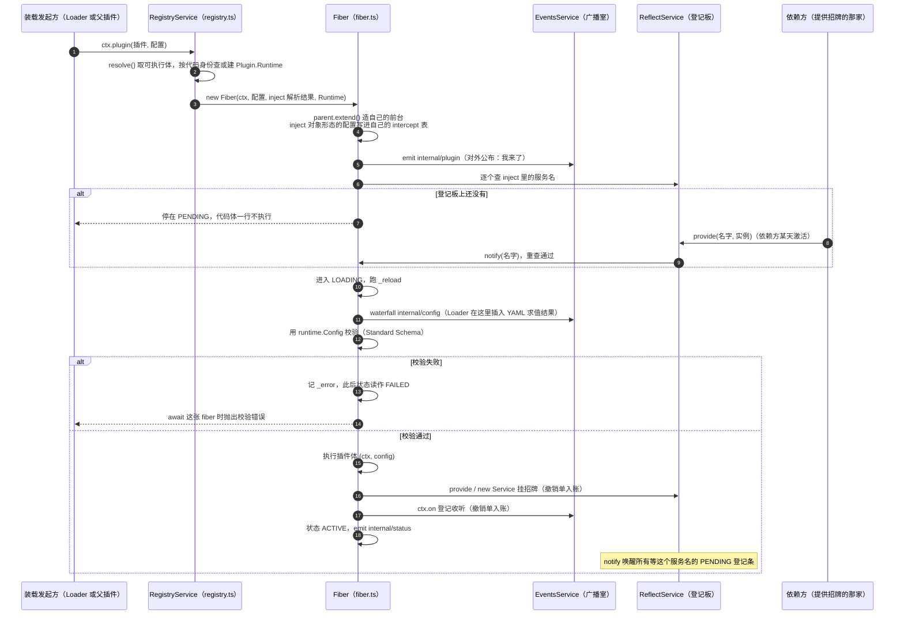
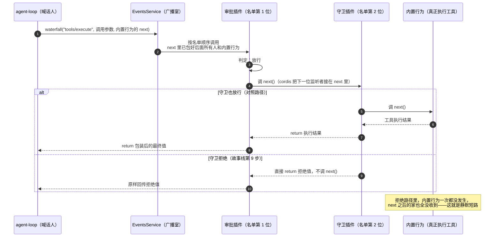
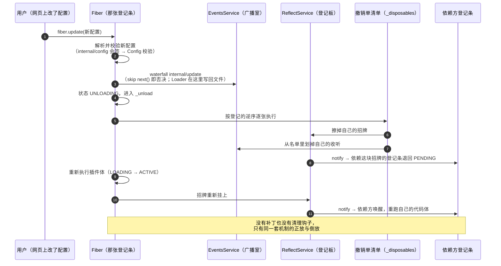

# Cordis 整体地图：术语 ↔ 比喻 ↔ 代码 一次性对齐

目的：把节点 1 出现过的每个词钉在一张表上，以后新词都往这张表里加，不再另起比喻。

## 一、只用一座比喻：一栋写字楼

Cordis = 一栋楼的**物业系统**。插件不是"组件"，是**入驻的商户**；能力不是"对象"，是商户**挂出的招牌**；事件不是"回调"，是**楼内广播和会签单**；日志不是"聊天记录"，是楼里只进不改的**档案室**。全表只围绕这一座楼。

| # | 术语（代码里的真名） | 这座楼里的比喻 | 一句话准确定义 | 在哪个文件 |
|---|---|---|---|---|
| 1 | `Context` / `ctx` | **一套前台**（含登记板、接待员、广播喇叭、门禁规则） | 插件眼中的那个对象，提供"按名字要能力"和"喊/听广播"两组动作 | 文件 vendor/cordis/src/context.ts |
| 2 | Proxy handler（`ReflectService.handler`） | **接待员本人** | 读格子时跑的那段代码：决定给不给你答案 | 文件 vendor/cordis/src/reflect.ts 第 135 行起 |
| 3 | 登记板（`ReflectService` 的属性表 + `Impl` 记录） | **招牌登记板** | 全局一张"名字 → 谁提供 → 提供者的档案条"的表 | 文件 vendor/cordis/src/reflect.ts |
| 4 | 服务 / service（`provide`、`new Service(ctx, name)`） | **挂出的招牌** | 登记板上的一条：一个名字对应一个可被别人使用的对象 | 文件 vendor/cordis/src/service.ts |
| 5 | 插件 / `Plugin`（函数 / class / `{ apply }`） | **一个商户** | 一段能力代码 + 随身的开业资料（名字、规格说明、需求清单、招牌名） | 文件 vendor/cordis/src/registry.ts 第 92 到 146 行 |
| 6 | 插件元数据 `name` / `Config` / `inject` / `provide` / `intercept` | **开业申请表** | 五个字段：招牌叫什么是后面四行填出来的来源 | 同上，`Plugin.Base` |
| 7 | `Plugin.Runtime` | **商户的工商档案**（一个商户一份） | 按代码身份去重：同一个商户开两次店，档案还是一份 | 文件 vendor/cordis/src/registry.ts 第 136 行 |
| 8 | `Fiber` | **一次入驻登记条** | 这一次装载的账本：状态、配置、我挂出去的招牌、我登记的收听、我的撤销清单 | 文件 vendor/cordis/src/fiber.ts |
| 9 | `FiberState`（PENDING / LOADING / ACTIVE / FAILED / UNLOADING / DISPOSED） | **入驻进度章** | 六枚章，决定这家店现在能不能被使用。注意 FAILED 不是被"盖"上的，而是 `_error` 非空时读出来的状态（fiber.ts:576） | 文件 vendor/cordis/src/fiber.ts 第 147 行 |
| 10 | `ctx.effect(execute, label)` | **在登记条上记一笔，同时拿到一张撤销单** | 立刻执行，把返回的撤销函数收进本账；卸载时逆序执行 | 文件 vendor/cordis/src/fiber.ts 第 415 行 |
| 11 | `_disposables` + `EffectMeta`（label + children） | **登记条背面的账页 + 页脚的层级注记** | 谁挂的招牌、谁听的广播、谁开的子商户，全在这一页；能按嵌套列成树 | 文件 vendor/cordis/src/fiber.ts |
| 12 | 事件总线 `EventsService` | **楼内广播室** | 全局一份事件名到收听者列表的表 | 文件 vendor/cordis/src/events.ts |
| 13 | `_hooks` | **每张喇叭下面的一列名单** | 事件名 → 一串收听者 | 文件 vendor/cordis/src/events.ts 第 132 行 |
| 14 | `Hook { ctx, callback, prepend, global }` | **名单上的一行**：谁的店、谁的手续、要不要抢在前 | 每条记录都存"登记人身在哪套前台"，用来过滤谁能听到 | 文件 vendor/cordis/src/events.ts 第 120 行 |
| 15 | `ctx.on(name, fn)` / `ctx.once` | **登记收听** | 走一次广播室的登记；同时在你的登记条上记一笔（含撤销单） | 文件 vendor/cordis/src/events.ts 第 288 行 |
| 16 | 五种分派 `emit` / `parallel` / `serial` / `bail` / `waterfall` | 五种通知方式：贴告示 / 挨家同时问完再走 / 挨家按序问等回复首个表态停 / 挨家按序问不等回复 / **会签单** | 由三问决定：等不等、要不要答案、谁能否决我 | 文件 vendor/cordis/src/events.ts 第 183 到 243 行 |
| 17 | `next`（waterfall 的参数） | **会签单上的"转下家"这一栏** | 一个函数。不填它，后面的家和内置行为都不发生 | 同上，第 234 行 |
| 18 | `isBailed(value)` | **算不算表态** | 不是 null、false、undefined 的都算表态 | 文件 vendor/cordis/src/events.ts 第 13 行 |
| 19 | `inject: ['tools']` | **申请表上写"我需要哪几家的服务"** | 决定你**什么时候被允许开业**：齐全才执行代码体，缺了就退回 | 文件 vendor/cordis/src/registry.ts |
| 20 | `ctx.get('x')` | **去问一句"现在有 x 吗"，没有就拉倒** | 只查当下，不排队等，返回对象或 undefined | 文件 vendor/cordis/src/reflect.ts |
| 21 | `ctx.extend(meta)` | **在同层隔出一套自己的门禁** | 造新前台，遮蔽不改老前台；新前台里可覆盖指定格子 | 文件 vendor/cordis/src/context.ts 第 99 行 |
| 22 | `ctx.isolate(name, label)` | **给某一块招牌单独立门牌** | 让这个服务名在这套前台下解析到另一个作用域；同 label 共享 | 同上，第 121 行 |
| 23 | `ctx.intercept(name, config)` | **给某家的招牌追加一条附加条款** | 给这个服务后续装载时的配置叠加一层 | 同上，第 139 行 |
| 24 | `Service[symbols.filter]`（比较 isolate label） | **这块招牌在这套门禁里算不算数** | 决定一次读取命中哪个实例 | 文件 vendor/cordis/src/service.ts 第 61 行 |
| 25 | `Config`（schemastery） | **装修规格说明书** | 装载前校验并算出真配置；不合法就 FAILED | 文件 vendor/schemastery/src/index.ts |
| 26 | `internal/*` 事件（`plugin` `status` `config` `update` `get` `set` `listener` `dispatch` `service`） | **物业内部频道** | 框架自己也用广播运作：装载、状态变更、配置求解、读写拦截都走这里 | 文件 vendor/cordis/src/events.ts 第 329 行起 |
| 27 | `root` 与 root fiber（`uid` 为 0） | **大堂本身** | 最早的那张登记条，四个内置服务挂在它名下 | 文件 vendor/cordis/src/context.ts 第 77 行 |
| 28 | `ctx.logger(name)` | **值班日志** | 带名字的记录口 | 文件 vendor/cordis/src/logger.ts |
| 29 | `CordisError('INACTIVE_EFFECT')` | **拿着已注销的登记条再想记账** | 账条已 DISPOSED 时再注册 effect 的报错 | 文件 vendor/cordis/src/fiber.ts 第 172 行 |
| 30 | `cordis.yml` / Loader / patch / HMR | **招商计划与它的热调整** | 把配置行变成商户、配置变更变成重开登记条 —— 节点 2 | 文件 vendor/loader/src/index.ts、vendor/include/src/index.ts、vendor/hmr/src/index.ts |
| 31 | 多层 profile / bundle / `--patch` | **总管理处逐级下发的招商补丁** | 有序叠加，上层可改写下层 —— 节点 12 | 文件 packages/boot/app-boot/src/profile.ts |
| 32 | `Scope`（dsh 的 per-agent 作用域） | **一家店给某个客户单独开的一套前台** | 把 isolate / extend / intercept 包装成"每个 agent 一套注册" —— 节点 3 | 文件 packages/core/scope/src/store.ts |
| 33 | `inject` 对象形态 / `@Inject(name, config)` | **申请表上"要哪家、加什么条款"** | 数组形态只要名字；对象形态给每个名字附一份拦截配置，装载时写进本前台的 intercept 表（fiber.ts:238-245）；方法装饰器把该方法调用推迟到服务可用 | 文件 vendor/cordis/src/registry.ts 第 19、37、71 行 |
| 34 | `[symbols.config]` 幽灵类型 + `InjectKey` | **招牌的类型铭牌** | 服务类带 `Service<T>` 类型参数，inject / @Inject 里给它的配置才有类型检查；没声明配置类型的服务不接受拦截配置 | 文件 vendor/cordis/src/service.ts 第 27 行、registry.ts 第 22 行 |
| 35 | `declare module '@deepseek-ai/cordis'` | **商户自己往章程里补类型** | dsh 包用它往 `Context` 加服务名（`ctx.tools` 才有类型）、往 `Events` 加事件名（`@mode` 才有归属） | 文件 packages/core/tools/src/index.ts 第 137 行、packages/llm/llm/src/index.ts 第 57 行 |
| 36 | `Entry` / `EntryOptions` | **一行招商计划** | 六个字段 id / name / config / group / disabled / inject；是数据不是代码，所以增删改商户不用改代码 | 文件 vendor/loader/src/config/entry.ts 第 10、43 行 |
| 37 | `EntryTree` / `EntryGroup` | **整本招商计划与它的目录** | 树按 id 索引行（嵌套 id 用 `:` 拼接），组持有行数组；create/remove/update 是**唯一带落盘的入口**（tree.write） | 文件 vendor/loader/src/config/tree.ts 第 7、97 行、group.ts 第 6 行 |
| 38 | `applyEntryPatches`（patch） | **总管理处逐层下发的改行指令** | 对配置行的纯函数改写：克隆后按 id 覆写，insert 的行立刻进索引，后层胜出；找不到就告警跳过 | 文件 vendor/include/src/index.ts 第 57 行 |
| 39 | `!!js` / `interpolate` | **现场求值的装修条款** | YAML tag 解析成 `{ __jsExpr }`，Loader 在 internal/config 里 `with(ctx) eval`；只在行 config 和 disabled 两处生效，树载体豁免 | 文件 vendor/loader/src/config/utils.ts 第 5、12 行、index.ts 第 104 行 |
| 40 | write-back | **账本回写** | 运行期变更（树 API、自杀式 dispose）写回 `entry.options` 并序列化落盘；Include 用 tmp+rename 原子写、debounce 合并 | 文件 vendor/loader/src/index.ts 第 115、149 行、include/src/index.ts 第 289 行 |
| 41 | `LocalRealm` / `GlobalRealm` | **行级门牌分区** | 行选项 `isolate` 给服务名生成隔离 symbol；同 `@标签` 共享一套——节点 3 的 dsh Scope 建在它上面 | 文件 vendor/loader/src/config/isolate.ts 第 26、49、60 行 |
| 42 | HMR 三分支 | **商户热换的分流闸** | 框架文件 → 全量重启；插件文件 → 清两级模块缓存后重导出、delete+重挂、失败回滚；配置文件 → Include.refresh() 重读 diff | 文件 vendor/hmr/src/index.ts 第 129、251 行 |
| 43 | capability seam 三角色 | **接缝上的三种铺子** | Definition 定契约、Provider 给实现、Consumer 只用不管；换 Provider 不动 Consumer。读插件先三问：provide 什么 / inject 什么 / on 什么 | 文件 docs/glossary.md（搜 seam）、docs/capability-seams.md；例 shell：dsh-shell / bash-local+bash-sandbox / tool-bash |
| 44 | session 事件日志（`Session` 私有数组 + `append`） | **档案室** | 所有插件共享的 append-only 流水账；每条记录带连续序号 `seq` 与时间；模型聊天记录由它派生 | 文件 packages/core/session/src/index.ts 第 446、722 行 |
| 45 | `SessionEventMap` + `ignorable` 角标 | **档案词表与"可跳过"角标** | 插件用声明合并添词；读方遇到不认识的词，无角标整卷拒读，有角标可跳过 | 文件 packages/core/session/src/types.ts 第 281、511 行；known-event-types.ts |
| 46 | 派生消息（`deriveMessages` + `SurfaceOp` 顶替） | **按档案誊一份给模型（上镜名单）** | 只有五类表面事件上镜；压缩 = 追加一条摘要并标明顶替谁，原文不动 | 文件 packages/core/session/src/index.ts 第 860 行；types.ts 第 439、462 行 |
| 47 | `SESSION_FORMAT_VERSION` 与相邻迁移 | **换柜不撕纸** | 版本号单调递增（现 4）；升级产出新版本文件，旧代原样封存；读取沿升级链翻译 | 文件 packages/core/session/src/types.ts 第 89 行；packages/session/session-format-v0-to-v1 … v3-to-v4 |
| 48 | 事件三域（session / agent / capability） | **三个广播频道** | 按事件属于谁分：对话记录→session；活体 agent→agent；能力本身→capability；全部按作用域话筒路由，向上可见 | 文件 docs/architecture.md 第 109 行；packages/core/agent/src/runtime-types.ts |
| 49 | 通知与闸门（emit vs waterfall / serial） | **通报与闸口** | emit 发完即走、不可否决；waterfall 层层表态、须调 next() 放行；serial 排队逐个表态、无 next() | 文件 packages/core/agent/src/dispatch.ts 第 63-81 行；runtime-types.ts 各事件 @mode |
| 50 | 三道闸（pre-step / request / turn-stopping） | **开跑前 / 发车前 / 收工前** | pre-step 否决或换材料；request 只换配置不碰消息；turn-stopping 反对 = steer 续工单；agent/created 为第四道开业闸（serial，回滚） | 文件 packages/core/agent/src/runtime-types.ts 第 320、337、381、261 行 |
| 51 | turn / step（回合 / 步） | **工单与工序** | turn = 从认领一批输入到没活儿收工，结束原因一并入档；step = 一次模型调用 + 它要求的全部工具执行；一个回合常有多步 | 文件 packages/core/agent-loop/src/agent.ts 第 296、398 行 |
| 52 | durable inbox / claim | **排队台账** | 收件箱分 next-turn / next-step 两格，每次进出都记一条事件（断电不丢队）；claim = 开跑前把整批从队列拿走 | 文件 packages/core/agent-loop/src/inbox.ts 第 109、227 行 |
| 53 | 请求 = 日志派生 + 冻结 | **先验票、后记账、再发车** | 请求 = 配置 + 从日志誊出并冻结的消息 + 工具清单；loop 不自存对话，重放日志即可复现请求 | 文件 packages/core/agent-loop/src/agent.ts 第 547、599 行 |
| 54 | 三道工具闸（pre-execute / execute / post-execute） | **安检三段** | 开跑前门卫四种表态（放行/拦下/取消/问人）；执行中包场护栏（超时重试）；跑完后验收（收下/退货） | 文件 packages/core/tools/src/index.ts 第 607、731 行；docs/tool-execution-pipeline.md |
| 55 | 单调门卫（ToolGuard） | **只会拦的保安** | 只回答"拦"或"不表态"，永远说不出"放行"——排队顺序翻不了案 | 文件 packages/core/tools/src/index.ts 第 731 行 |
| 56 | 审批接缝（`ctx.approval`） | **问人的传话筒** | ask 决定沿作用域话筒递给能拍板的前端（终端/网页/SDK）；答不了算拦；问答都入档 | 文件 packages/interaction/user-approval/src/index.ts 第 150、282 行 |
| 57 | 段落拼装（section + 中央排号） | **各报各的编号段落** | 系统提示 = 各插件带唯一名字、统一分配编号的段落排队拼接；稳定内容在前、本机易变在后 | 文件 packages/core/system-prompt/src/index.ts 第 53、125 行 |
| 58 | 缓存前缀与运行时快照 | **开头不动省钱，易变走后门** | 逐字节相同的开头可复用模型侧缓存；每步都变的运行时上下文作为用户角色快照消息追加 | 文件 packages/core/system-prompt/src/index.ts 第 303 行；packages/context/* |
| 59 | agent.inject() | **挂来源标记的插话** | 文件变更、技能内容、定时通知等经用户消息通道入档上镜，靠 source 区分来源 | 文件 packages/core/session/src/types.ts 第 308 行 |
| 60 | 中立词表（消息 / 流 / 统一失败） | **口岸世界语** | 口岸内侧只讲消息词表与流词表，错误统一带稳定代码；厂商方言挡在口岸外 | 文件 packages/llm/llm/src/types.ts；docs/cookbook/adding-an-llm-adapter.md |
| 61 | LLM adapter | **翻译官** | 继承基类、核心一个 stream 方法；注册是 effect、一条路线一个翻译官；参考实现直连与包 SDK 各一 | 文件 packages/llm/llm/src/index.ts 第 396 行；packages/llm/llm-deepseek/src/adapter.ts |
| 62 | prepareCall 票根 | **验票台** | 验票时定下厂商默认值、窗口大小、系统提示与工具增补的处理方式；loop 只认票根不认厂商名 | 文件 packages/llm/llm/src/index.ts 第 278 行；packages/core/agent-loop/src/agent.ts 第 547 行 |
| 63 | 执行世界三件套 | **同一台机器的三张执照** | fs + subprocess + sandbox 描述同一个世界、成套换装；bash 与 PTY 骑在 subprocess 上 | 文件 packages/subprocess/subprocess/src/index.ts 第 95 行；packages/fs/fs/src/index.ts 头注 |
| 64 | argv 包装（confine） | **笼子是外壳不是监工** | 先把命令裹上笼子程序和规则再开跑；策略按每次调用携带；没有笼子宁可拒绝开跑 | 文件 packages/sandbox/sandbox/src/index.ts 第 177、125 行 |
| 65 | fs 意图闸（write/edit-intent） | **动手前的小闸** | 单槽瀑布：第一个亮出意图的监听者独占决定；动手后 fs/observed 广播记账 | 文件 packages/fs/fs/src/index.ts 第 59、67、77 行 |
| 66 | subagent 名册 | **按名点将** | ctx.subagents 名册制：Provider 报名、调用者按名选；一次性与可续派两种分身；传话不暴露分身居所 | 文件 packages/subagent/subagent/src/index.ts 头注；tool-subagent/src/index.ts 第 45 行 |
| 67 | jobs 登记处 | **后台号牌台** | 后台任务统一登记：号牌 + 有界环形输出（模型书签与旁观者偏移互不打扰）；活得比插件久 | 文件 packages/jobs/jobs/src/index.ts 头注 |
| 68 | workflow 剧本 | **只播报的导演** | 编排脚本喊阶段/日志/分身起止，全是不可否决的 emit；观察与控制分家 | 文件 packages/workflow/workflow/src/index.ts 第 2 行 |
| 69 | profile（有序 bundles + 薄改） | **装修方案** | 一份组合单：有序列出各 bundle 的改单，再叠自己与用户的薄页；树仍是数据 | 文件 packages/boot/app-boot/src/profile.ts:1-22 |
| 70 | 层序（bundle → profile → home → --patch） | **后贴的改先贴的** | 四层叠加、后来者居上；组合与 dump 共用 02 课同一把纯函数尺子 | 文件 packages/boot/app-boot/src/profile.ts 第 710 行 |
| 71 | 发射白名单 | **只有物业能点火** | 只有 dsh profile 启动器可启动受支持的 Node 应用；SDK 只能选方案名+有序薄改 | 文件根 AGENTS.md（Application launch） |

## 二、全景图（一张，字写全）

读法：**左边一列是"楼是怎么定下来的"，中间是"一家店进来会发生什么"，右边是"店营业时只有两类动作"，下面是"店走了会发生什么"。** 你之前所有零碎问题（为什么要 inject、fiber 是什么、next 不调会怎样、环依赖为什么静默）分别落在这四段的同一处。

## 三、三张时序图（生 / 营业 / 死与重生）

全景图是空间视图；时序图是时间视图。同一套机制，换一个方向再看一遍。

### 时序图一：一家店的生（装载与依赖唤醒）

对应 `fiber.ts` 的构造器与 `_reload`。两条主线：依赖齐不齐决定"现在执行还是等"；配置过不过决定"执行成功还是 FAILED"。

### 时序图二：营业（一次被守卫拦下的工具调用）

对应 `events.ts:234` 的 waterfall 实现。审批先收到并放行，守卫后收到但拒绝——故事线第 9 步的时间线版本。

### 时序图三：死与重生（改配置 → 卸载 → 重跑）

对应 `fiber.ts` 的 `update()` / `_unload()` / `_reload()`。注意顺序：先解析校验新配置，再过 `internal/update` 会签（此时不调 `next()` 即否决）。

## 四、贯穿全程的一条故事线（把 42 个术语串一遍）

以"一次工具调用被审批拦下，随后改了配置"为例，按时间顺序走一遍。每一步给术语名和楼里的比喻名。

1. 招商计划 `cordis.yml`（#30）里有一行 tools 商户；Loader 读出它，调 `ctx.plugin(...)`（#5、#8）。
2. `RegistryService.plugin()`（#5）用代码身份查 `Plugin.Runtime`（#7）：这家店的工商档案已存在就复用，只新建一张**入驻登记条**（#8 `Fiber`）。
3. 新登记条先读申请表（#6）：先过 `internal/config` 会签（Loader 在这里插入 YAML 求值结果，#26、#30），再用 `Config` 规格说明书（#25）校验；不合法记 `_error`，此后状态读作 FAILED（#9）；合法才继续。
4. 申请表上写着 `inject: ['llm']`（#19）。接待员（#2）去招牌登记板（#3）查 `llm`——没有。于是这家店停在 PENDING（#9），**代码体一行都没执行**。这就是"没有加载顺序，只有需求是否满足"。
5. 另一家提供 `llm` 招牌的商户先开了业，登记板上多了一条（#4）。广播室的内部频道（#26）递出状态变化，第 4 步那张登记条被唤醒，盖 ACTIVE 章，现在执行代码体。
6. 代码体干三件事，每件都在账页（#11）上留下一笔加一张撤销单（#10）：挂出自己的招牌（`provide`）、登记收听 `tools/execute`（#14、#15）、可能再装子商户（#8，子登记条的撤销单挂在父登记条的账上）。
7. 用户提了一句，agent-loop 要执行一次工具，于是**喊一声**（#16 里的 waterfall）：`tools/execute`，参数末尾放一个 `next` 函数（#17）。
8. 广播室按名单（#13）取出收听者，**每条名单都记得登记人身在哪套前台**（#14），所以别的 agent 的那家店的收听不会被这一套前台的喊声打扰（#21、#24）。
9. 审批那家先收到，它填了"转下家"（调 `next`）；守卫那家收到，**它没填**，直接返回一个值——于是内置行为（真正执行工具）一次都没发生，`next` 后面的家也全没收到。
10. 你在网页上关掉一个插件。HMR / Loader（#30）改的是招商计划，落到第 6 步那张账页上：dispose（#8）→ 盖 UNLOADING 章 → **按登记的反序执行撤销单**（#10、#11）：擦掉它的招牌、从每张名单里划掉它的收听、注销它的子商户。
11. 招牌一没，第 5 步那种"唤醒"反过来发生：依赖它的登记条从 ACTIVE 退回 PENDING（#9）。配置改完，招牌重新挂上，它把代码体**再执行一遍**。这就是为什么"没有卸载泄漏"不是靠人守规矩。
12. 全程每一步都可写进值班日志（#28）；任何一步在已注销的登记条上记账都会抛 `INACTIVE_EFFECT`（#29）。

## 五、地图上还空着的格子（都是有名字的空位，不是遗漏）

| 空位 | 对应节点 | 会回答什么 |
|---|---|---|
| 广播名单如何变成有类型、可核对声明的事件；`@mode` 从哪来 | 节点 5 | 事件域怎么选 |
| 第 7 步那个"内置行为"到底是谁、链在哪几处 | 节点 6、7 | turn / step 与工具流水线 |
| 前台之外：招牌被谁写进磁盘、日志（session log）与这套登记板什么关系 | 节点 4 | 模型可见 ⟺ 可重建 |
