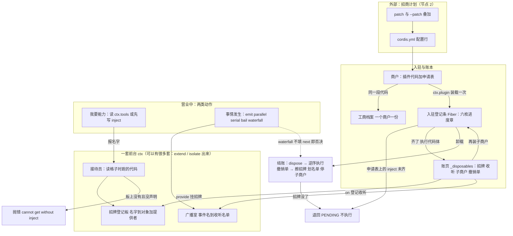

# Cordis 整体地图：术语 ↔ 比喻 ↔ 代码 一次性对齐

目的：把节点 1 出现过的每个词钉在一张表上，以后新词都往这张表里加，不再另起比喻。

## 一、只用一座比喻：一栋写字楼

Cordis = 一栋楼的**物业系统**。插件不是"组件"，是**入驻的商户**；能力不是"对象"，是商户**挂出的招牌**；事件不是"回调"，是**楼内广播和会签单**。全表只围绕这一座楼。

| # | 术语（代码里的真名） | 这座楼里的比喻 | 一句话准确定义 | 在哪个文件 |
|---|---|---|---|---|
| 1 | `Context` / `ctx` | **一套前台**（含登记板、接待员、广播喇叭、门禁规则） | 插件眼中的那个对象，提供"按名字要能力"和"喊/听广播"两组动作 | 文件 vendor/cordis/src/context.ts |
| 2 | Proxy handler（`ReflectService.handler`） | **接待员本人** | 读格子时跑的那段代码：决定给不给你答案 | 文件 vendor/cordis/src/reflect.ts 第 135 行起 |
| 3 | 登记板（`ReflectService` 的属性表 + `Impl` 记录） | **招牌登记板** | 全局一张"名字 → 谁提供 → 提供者的档案条"的表 | 文件 vendor/cordis/src/reflect.ts |
| 4 | 服务 / service（`provide`、`new Service(ctx, name)`） | **挂出的招牌** | 登记板上的一条：一个名字对应一个可被别人使用的对象 | 文件 vendor/cordis/src/service.ts |
| 5 | 插件 / `Plugin`（函数 / class / `{ apply }`） | **一个商户** | 一段能力代码 + 随身的开业资料（名字、规格说明、需求清单、招牌名） | 文件 vendor/cordis/src/registry.ts 第 92 到 146 行 |
| 6 | 插件元数据 `name` / `Config` / `inject` / `provide` / `intercept` | **开业申请表** | 五个字段：招牌叫什么是后面四行填出来的来源 | 同上，`Plugin.Base` |
| 7 | `Plugin.Runtime` | **商户的工商档案**（一个商户一份） | 按代码身份去重：同一个商户开两次店，档案还是一份 | 文件 vendor/cordis/src/registry.ts 第 136 行 |
| 8 | `Fiber` | **一次入驻登记条** | 这一次装载的账本：状态、配置、我挂出去的招牌、我登记的收听、我的撤销清单 | 文件 vendor/cordis/src/fiber.ts |
| 9 | `FiberState`（PENDING / LOADING / ACTIVE / FAILED / UNLOADING / DISPOSED） | **入驻进度章** | 六枚章，决定这家店现在能不能被使用 | 文件 vendor/cordis/src/fiber.ts 第 147 行 |
| 10 | `ctx.effect(execute, label)` | **在登记条上记一笔，同时拿到一张撤销单** | 立刻执行，把返回的撤销函数收进本账；卸载时逆序执行 | 文件 vendor/cordis/src/fiber.ts 第 415 行 |
| 11 | `_disposables` + `EffectMeta`（label + children） | **登记条背面的账页 + 页脚的层级注记** | 谁挂的招牌、谁听的广播、谁开的子商户，全在这一页；能按嵌套列成树 | 文件 vendor/cordis/src/fiber.ts |
| 12 | 事件总线 `EventsService` | **楼内广播室** | 全局一份事件名到收听者列表的表 | 文件 vendor/cordis/src/events.ts |
| 13 | `_hooks` | **每张喇叭下面的一列名单** | 事件名 → 一串收听者 | 文件 vendor/cordis/src/events.ts 第 132 行 |
| 14 | `Hook { ctx, callback, prepend, global }` | **名单上的一行**：谁的店、谁的手续、要不要抢在前 | 每条记录都存"登记人身在哪套前台"，用来过滤谁能听到 | 文件 vendor/cordis/src/events.ts 第 120 行 |
| 15 | `ctx.on(name, fn)` / `ctx.once` | **登记收听** | 走一次广播室的登记；同时在你的登记条上记一笔（含撤销单） | 文件 vendor/cordis/src/events.ts 第 288 行 |
| 16 | 五种分派 `emit` / `parallel` / `serial` / `bail` / `waterfall` | 五种通知方式：贴告示 / 挨家同时问完再走 / 挨家按序问等回复首个表态停 / 挨家按序问不等回复 / **会签单** | 由三问决定：等不等、要不要答案、谁能否决我 | 文件 vendor/cordis/src/events.ts 第 183 到 243 行 |
| 17 | `next`（waterfall 的参数） | **会签单上的"转下家"这一栏** | 一个函数。不填它，后面的家和内置行为都不发生 | 同上，第 234 行 |
| 18 | `isBailed(value)` | **算不算表态** | 不是 null、false、undefined 的都算表态 | 文件 vendor/cordis/src/events.ts 第 13 行 |
| 19 | `inject: ['tools']` | **申请表上写"我需要哪几家的服务"** | 决定你**什么时候被允许开业**：齐全才执行代码体，缺了就退回 | 文件 vendor/cordis/src/registry.ts |
| 20 | `ctx.get('x')` | **去问一句"现在有 x 吗"，没有就拉倒** | 只查当下，不排队等，返回对象或 undefined | 文件 vendor/cordis/src/reflect.ts |
| 21 | `ctx.extend(meta)` | **在同层隔出一套自己的门禁** | 造新前台，遮蔽不改老前台；新前台里可覆盖指定格子 | 文件 vendor/cordis/src/context.ts 第 99 行 |
| 22 | `ctx.isolate(name, label)` | **给某一块招牌单独立门牌** | 让这个服务名在这套前台下解析到另一个作用域；同 label 共享 | 同上，第 121 行 |
| 23 | `ctx.intercept(name, config)` | **给某家的招牌追加一条附加条款** | 给这个服务后续装载时的配置叠加一层 | 同上，第 139 行 |
| 24 | `Service[symbols.filter]`（比较 isolate label） | **这块招牌在这套门禁里算不算数** | 决定一次读取命中哪个实例 | 文件 vendor/cordis/src/service.ts 第 61 行 |
| 25 | `Config`（schemastery） | **装修规格说明书** | 装载前校验并算出真配置；不合法就 FAILED | 文件 vendor/schemastery/src/index.ts |
| 26 | `internal/*` 事件（`plugin` `status` `config` `update` `get` `set` `listener` `dispatch` `service`） | **物业内部频道** | 框架自己也用广播运作：装载、状态变更、配置求解、读写拦截都走这里 | 文件 vendor/cordis/src/events.ts 第 329 行起 |
| 27 | `root` 与 root fiber（`uid` 为 0） | **大堂本身** | 最早的那张登记条，四个内置服务挂在它名下 | 文件 vendor/cordis/src/context.ts 第 77 行 |
| 28 | `ctx.logger(name)` | **值班日志** | 带名字的记录口 | 文件 vendor/cordis/src/logger.ts |
| 29 | `CordisError('INACTIVE_EFFECT')` | **拿着已注销的登记条再想记账** | 账条已 DISPOSED 时再注册 effect 的报错 | 文件 vendor/cordis/src/fiber.ts 第 172 行 |
| 30 | `cordis.yml` / Loader / patch / HMR | **招商计划与它的热调整** | 把配置行变成商户、配置变更变成重开登记条 —— 节点 2 | 文件 vendor/loader/src/index.ts、vendor/include/src/index.ts、vendor/hmr/src/index.ts |
| 31 | 多层 profile / bundle / `--patch` | **总管理处逐级下发的招商补丁** | 有序叠加，上层可改写下层 —— 节点 12 | 文件 packages/boot/app-boot/src/profile.ts |
| 32 | `Scope`（dsh 的 per-agent 作用域） | **一家店给某个客户单独开的一套前台** | 把 isolate / extend / intercept 包装成"每个 agent 一套注册" —— 节点 3 | 文件 packages/core/scope/src/store.ts |

## 二、整体图（一张，不再拆场景）

读法：**左边一列是"楼是怎么定下来的"，中间是"一家店进来会发生什么"，右边是"店营业时只有两类动作"，下面是"店走了会发生什么"。** 你之前所有零碎问题（为什么要 inject、fiber 是什么、next 不调会怎样、环依赖为什么静默）分别落在这四段的同一处。

## 三、贯穿全程的一条故事线（把 32 个术语串一遍）

以"一次工具调用被审批拦下，随后改了配置"为例，按时间顺序走一遍。每一步给术语名和楼里的比喻名。

1. 招商计划 `cordis.yml`（#30）里有一行 tools 商户；Loader 读出它，调 `ctx.plugin(...)`（#5、#8）。
2. `RegistryService.plugin()`（#5）用代码身份查 `Plugin.Runtime`（#7）：这家店的工商档案已存在就复用，只新建一张**入驻登记条**（#8 `Fiber`）。
3. 新登记条先读申请表（#6）：`Config` 规格说明书（#25）过一遍配置，不合法直接盖 FAILED 章（#9）；合法才继续。
4. 申请表上写着 `inject: ['llm']`（#19）。接待员（#2）去招牌登记板（#3）查 `llm`——没有。于是这家店停在 PENDING（#9），**代码体一行都没执行**。这就是"没有加载顺序，只有需求是否满足"。
5. 另一家提供 `llm` 招牌的商户先结了业，登记板上多了一条（#4）。广播室的内部频道（#26）递出状态变化，第 4 步那张登记条被唤醒，盖 ACTIVE 章，现在执行代码体。
6. 代码体干三件事，每件都在账页（#11）上留下一笔加一张撤销单（#10）：挂出自己的招牌（`provide`）、登记收听 `tools/execute`（#14、#15）、可能再装子商户（#8，子登记条的撤销单挂在父登记条的账上）。
7. 用户提了一句，agent-loop 要执行一次工具，于是**喊一声**（#16 里的 waterfall）：`tools/execute`，参数末尾放一个 `next` 函数（#17）。
8. 广播室按名单（#13）取出收听者，**每条名单都记得登记人身在哪套前台**（#14），所以别的 agent 的那家店的收听不会被这一套前台的喊声打扰（#21、#24）。
9. 审批那家先收到，它填了"转下家"（调 `next`）；守卫那家收到，**它没填**，直接返回一个值——于是内置行为（真正执行工具）一次都没发生，`next` 后面的家也全没收到。
10. 你在网页上关掉一个插件。HMR / Loader（#30）改的是招商计划，落到第 6 步那张账页上：dispose（#8）→ 盖 UNLOADING 章 → **按登记的反序执行撤销单**（#10、#11）：擦掉它的招牌、从每张名单里划掉它的收听、注销它的子商户。
11. 招牌一没，第 5 步那种"唤醒"反过来发生：依赖它的登记条从 ACTIVE 退回 PENDING（#9）。配置改完，招牌重新挂上，它把代码体**再执行一遍**。这就是为什么"没有卸载泄漏"不是靠人守规矩。
12. 全程每一步都可写进值班日志（#28）；任何一步在已注销的登记条上记账都会抛 `INACTIVE_EFFECT`（#29）。

## 四、地图上还空着的格子（都是有名字的空位，不是遗漏）

| 空位 | 对应节点 | 会回答什么 |
|---|---|---|
| 招商计划怎么被解析、多层 patch 按什么顺序叠加 | 节点 2 | 为什么改 YAML 不改代码就能换商户 |
| 一套前台如何变成"每个 agent 一套"（dsh 的 Scope 建在 #21/#22/#23 上） | 节点 3 | 为什么换 provider 不惊动使用者 |
| 广播名单如何变成有类型、可核对声明的事件；`@mode` 从哪来 | 节点 5 | 事件域怎么选 |
| 第 7 步那个"内置行为"到底是谁、链在哪几处 | 节点 6、7 | turn / step 与工具流水线 |
| 前台之外：招牌被谁写进磁盘、日志（session log）与这套登记板什么关系 | 节点 4 | 模型可见 ⟺ 可重建 |
