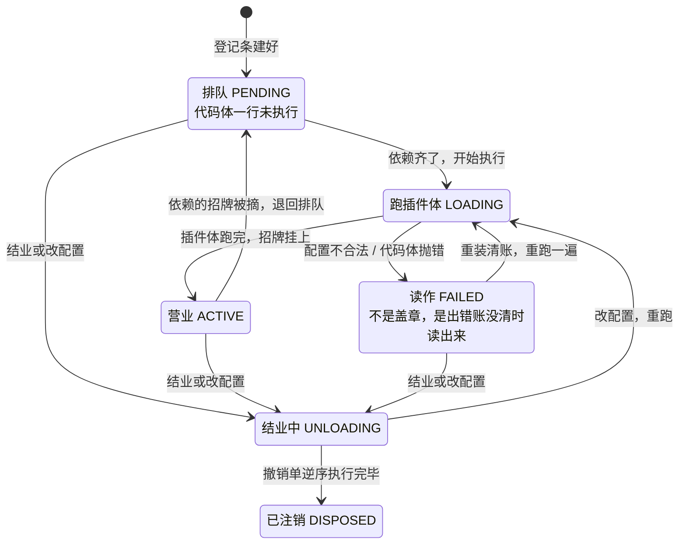

# 01 — Cordis 内核：一切插件的地基

> 本课回答：一段普通代码怎么变成"插件"、被装进系统、和其他插件打交道。dsh 的每个能力——调模型、执行工具、审批、日志——都是这样装进来的插件。这一课是后面所有课的公共底座。

## 逻辑层

### 一、前台：插件看到的唯一入口（ctx）

**大白话**：插件不直接认识别的插件，它只认识"前台"。要能力，去前台报名字；要插手，去前台登记收听。前台背后有两块板子：**登记板**（名字 → 谁在提供这项能力）和**广播室**（每个事件名对应一列收听者）。

**术语**：这套前台在代码里叫 `ctx`（Context），dsh 所有插件都靠它打交道。

**推论**：一切都经前台，所以"把某项能力换成别的做法"时，别的插件毫无感觉——这是后面"换 provider 不改使用者"的地基。

### 二、开业：没有加载顺序，只有"需求是否满足"（inject）

**大白话**：插件开业前先交一张申请表，写清"我需要哪几家已有商户"。前台查登记板：齐了 → 立刻开业；不齐 → 排队等，缺的那家一开业就自动叫醒它。写配置的人**完全不用操心谁先谁后**。

**术语**：申请表上的依赖叫 `inject`；"排队等"内部叫 PENDING，"营业中"叫 ACTIVE（其余状态名不用记）。

**例子**：tools 插件写 `inject: ['llm']`——模型服务没好，它一行代码都不执行；好了，它自动开张。

**推论**：删掉一个插件，依赖它的插件自动退回等待而不是崩溃；装回来，它自动重新开业。所以"开关插件"是安全的、可逆的。

### 三、做生意只有两种方式：拉服务、推事件

**大白话**：
- **拉（要能力）**：我需要一个固定伙伴 → 申请表写它的名字，然后直接用。像雇人。
- **推（要插手）**：我想在某件事发生时被通知，甚至拦一道 → 去广播室登记收听。像订阅公众号。

**术语**：固定依赖用服务，可插拔的扩展点用事件。事件有五种喊法，记三问口诀：① 要不要答案？要"层层包装"→ waterfall；要"第一个表态就停"→ bail / serial。② 不要答案：要不要等大家跑完？要 → parallel；不要 → emit。③ 这事允不允许被否决？纯通知绝不能用 waterfall。

**例子**：工具执行前要过"审批"——内核喊一声 waterfall（会签单），审批插件先收到：放行就调用 `next()` 把活儿传给下一位；拒绝就**不调** `next()` 直接返回。

**推论**：waterfall 里不调 `next()` = 否决后面所有人和默认行为，而且**一声不响**。"审批拦截"不需要任何专门机制，就是这条规则的正常用法。

### 四、结业：账本保证可逆

**大白话**：插件每做一次登记（挂招牌、订广播、开分店），前台自动记一笔账、留一张"撤销单"。结业时不用人收拾——把撤销单**按登记的反序**全部执行：招牌摘掉、订阅退掉、分店关门。

**术语**：这本账叫 Fiber（每装一次一张）；执行撤销单叫 dispose。名字不用记，机制要懂。

**推论**：卸载永远干净，"忘记清理"这类 bug 没有生存空间——靠的是机制，不是纪律。

### 五、配置：开业前先过规格审查

**大白话**：插件可以声明一份配置规格。装载时先校验：合法 → 带着配置开业；不合法 → 拒绝开业（内部标记为 FAILED），绝不开一家"装修不规范"的店。

**推论**：配置错误在装载当场暴露，不会拖到运行中途才炸。

一张登记条的一生（六个章，名字不用背，看形状）：

读法：要带走的只有形状——排队与营业来回翻转（开关插件安全可逆）；FAILED 是"读"出来的不是"盖"上的；进结业必先过撤销单。

## 记住什么 / 不用记什么

**记（5 个）**：前台（ctx）；inject——需求满足，不是加载顺序；拉服务与推事件（三问口诀）；waterfall 必须调 `next()`（否则静默否决）；登记留撤销单（卸载必然可逆）。

**不用记**（卡住回溯）：Fiber 六状态的名字、`ReflectService` / `RegistryService` 等类名、`internal/*` 内部事件、五种喊法的实现、`@Inject` 装饰器、TypeScript 类型声明合并——地址见下表。

## 源码层（回溯地址，不要求读）

| 想查什么 | 地址 |
|---|---|
| 前台 / 登记板 / 广播室 | `vendor/cordis/src/context.ts`；读名字时跑的代码 `reflect.ts:136`；五种喊法 `events.ts:32`；waterfall `events.ts:234` |
| 申请表与装载 | `registry.ts:19`（inject 类型）、`registry.ts:316`（ctx.plugin） |
| 账本与状态 | `fiber.ts:147`（状态机）、`fiber.ts:574`（FAILED 是"读"出来的）、`fiber.ts:675`（逆序撤销） |
| 服务基类与门牌 | `service.ts:61`（哪套前台命中哪个实例） |
| inject 对象形态 / 类型从哪来 | `registry.ts:22`、`packages/core/tools/src/index.ts:137` |
| 原始精读版（含实跑 demo 与自测答案） | `lessons/01-cordis-kernel.md`、`lessons/demos.md` |

## 自测（可选）

用一句话回答：为什么"在配置里调整插件加载顺序"这个功能在 Cordis 里根本不需要存在？
