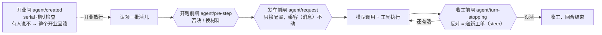

# 05 — Agent 事件域：观察它、拦住它、放它走

> 本课回答两个问题：观察、控制一个 agent，分别用什么事件？一条新事件该登记在哪个域、用什么方式发？接缝：01 课讲了"推事件"的五种方式，03 课讲了 Scope 决定谁能听见，04 课读了 session 频道的发声者；本课把三者合成 dsh 的事件地图——主线不变量②（选域先于选包）的老家。

## 逻辑层

### 一、事件三域：先想清楚"这件事属于谁"

**大白话**：楼里的广播不是一个大喇叭，而是分频道，按"这件事属于谁"分：属于**某次对话记录**的（要进档案）走 session 频道；属于**某个活着的 agent** 的（排队、忙闲、流式输出、拦截控制）走 agent 频道；属于**某件能力本身**的（工具要执行、模型流要发、文件要写）走能力频道。

**术语**：三个事件域（session / agent / capability）。每条广播都带着 03 课那只"作用域话筒"——上级前台听得见自己名下所有 agent 的一切，平级互相听不见。比如工具执行前的那道广播（`tools/pre-execute`）名义上是能力频道的，但总管照样听得见自己每个 agent 的工具调用。

**例子**：网页上实时显示"正在打字"——听 agent 频道的 `agent/assistant-stream`；回放一份完整对话——听 session 频道的 `session/event`（官方明说：要重放稿件就消费它，agent 频道只是活体协调）。

**推论**：这就是不变量②"选域先于选包"的字面意思。事件放错域，后果是别人在错误的频道上找它——先问属于谁，再问放哪个包。

### 二、通知与闸门：emit 天生不可否决

**大白话**：广播分两种。**通知**是"告诉你一声"：话音落地事情已经定了，谁也不能靠喊一嗓子拦住它。**闸门**是"等你表态"：事情停在闸口，监听者一个个表态后才放行。

**术语**：通知 = emit（发完即走，监听器出错只记日志、不影响任何人）；闸门 = waterfall（层层表态，必须调 `next()` 才放行，最后一环的表态就是决定）和 serial（排队逐个表态，没有 `next()`）。用 01 课的三问判别：要不要等结果？有没有返回值？要不要人人表态？

**例子**：`agent/status`（忙⇄闲）是通知——界面靠它刷新，谁也拦不住"agent 变忙了"；`agent/pre-step` 是闸门——监听者可以否决即将开跑的这一步。

**推论**：想拦一件事，必须站在闸门上；在通知频道上吆喝拦不住任何事。这是不变量⑤"强制要发生在做决定的那个操作里"在事件世界的样子。

### 三、三道闸：开跑前、发车前、收工前

**大白话**：agent 的一轮工作像一趟车，路上有三道闸。**开跑前**：这一步跑不跑？带哪些材料？监听者可以否决，也可以换掉带上去的材料。**发车前**：最后改一次配置——用哪个模型、什么参数——但车厢里的乘客（消息内容）不能动，动乘客必须回档案室记账。**收工前**：监听者不投否决票，而是递一张新工单（续一条新指令），机器看到还有活就继续干，干完再来收工。

**术语**：`agent/pre-step`（waterfall，返回值是权威决定）、`agent/request`（waterfall，只换配置、不可碰消息）、`agent/turn-stopping`（serial，没有 `next()`，反对 = steer 续工单）。第四道特殊的闸是开业时：`agent/created`（serial 排队检查），任何一家监听者说不，整个开业回滚——01 课账本的回卷机制。

**例子**：plan-mode 插件（计划模式）守在开跑前那道闸上：计划模式下，这一步的提案先经它把关；webhook 插件守在发车前那道闸上。

**推论**：三道闸对应三种介入姿势——**否决、改写、续期**。姿势选错了就白搭：在通知频道上想否决，行不通。

三道闸在一轮工作路上的位置：

读法：三道闸各管一种介入姿势——否决、改写、续期；开业闸是第四道，管的不是一轮而是存在本身。

### 四、三问检验：守闸的人

拿三问读 `dsh-plan-mode`：**provide** 什么——`ctx.planMode`（计划模式开关的招牌）；**inject** 什么——`['tools', 'systemPrompt', 'sessionProjections']`；**on** 什么——`agent/pre-step`。它不碰 loop 的代码，只在闸门上表态："插件，不改 loop"的又一次兑现。

## 记住什么 / 不用记什么

**记（4 个）**：事件三域（session / agent / capability）；通知与闸门（emit 只通报，waterfall / serial 才有决定权）；三道闸（pre-step 否决 / request 改配置 / turn-stopping 续期）；选域先于选包。

**不用记**（卡住回溯）：`agentEvents` / `agentCarrier`（把 agent 和它的作用域话筒焊在一起的转发器）、`AgentSubjectEvent` 类型判别、`AgentRegistry` 与 initiator 栈、`agent/inbox/*` 的细分名、各事件的监听者名单（查矩阵文档）、steer 的实现细节。

## 源码层（回溯地址，不要求读）

| 想查什么 | 地址 |
|---|---|
| 三个域的官方分界 | `docs/architecture.md:109`（持久会话事件 vs 三个域的实时扩展点；waterfall 名单；turn-stopping 无 next()） |
| agent 事件全表（每条带 @mode） | `packages/core/agent/src/runtime-types.ts:261-393` |
| 三道闸的准确语义 | pre-step `:320`（返回值即权威决定）；request `:337`（换配置、不可碰消息）；turn-stopping `:381`（反对 = steer，数据说了算） |
| agent/created 串行初始化与回滚 | `runtime-types.ts:261`（抛错即失败、跳过后续）；工厂回滚 `packages/core/agent/src/index.ts` |
| 域 × 作用域的焊点 | `packages/core/agent/src/dispatch.ts:94`（agentCarrier）、`:107`（agentEvents 三种 dispatch） |
| 谁发谁听总表 | `docs/event-producer-consumer.md`（生成矩阵：每条事件的 mode、发方、听方） |
| 一轮对话的完整时序 | `docs/agent-lifecycle.md`（每条事件落位的时序图） |
| 贯穿实例 | `packages/plan/plan-mode/src/index.ts:177`（inject）、`:197`（on agent/pre-step） |

## 自测（可选）

1. 想写一个插件"每次模型调用前把温度参数强制改成 0"——用哪个事件？为什么不能顺手用它改消息内容？
2. 某插件在 `agent/status` 监听器里抛了异常，agent 会因此停住吗？想在工具执行前拦下某次调用，又该站在哪条事件上？
