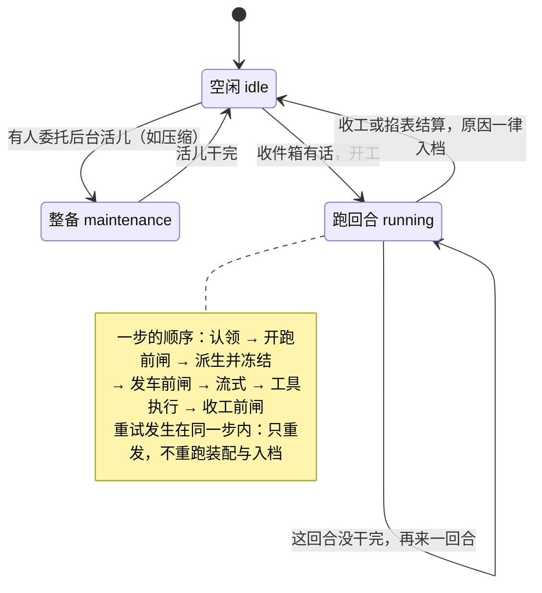

# 06 — agent-loop 状态机：一轮对话怎么转

> 本课回答两个问题：一轮对话内部怎么转（turn 和 step 各是什么）？取消、重试各落在哪一步？接缝：04 课的档案、05 课的闸门在这一课全部用上——loop 自己是个普通插件（01 课），手里几乎不留状态：每个请求都从日志现算。

## 逻辑层

### 一、回合与步：turn = 一批活儿，step = 一次模型调用 + 它的工具执行

**大白话**：你发一句话到拿到最终答复，中间常常不是一个来回。一**回合**，是从你这句话（或排队的一批话）被拿去处理，到 agent 认为没活儿了为止；一**步**，是模型被调用一次，加上它这次要求执行的全部工具。模型看完工具结果想继续干，就在同一回合里再走一步——所以一个回合常常好几步。

**术语**：回合记 `turn/start`…`turn/end`（结束原因一并入档：正常完成、被打断、出错、顶到长度上限……）；步记 `step/start`…`step/end`。

**例子**：你说"帮我改代码并跑测试"——一步改代码、调工具跑测试，看结果有错，再一步修错、再跑——一个回合走了好几步才收工。

**推论**：什么时候收工由**数据**决定，不由谁的态度决定：模型不再要工具、收件箱没有新插话，才关门。就算进程崩在半截，恢复程序也照 04 课的规矩补一条"被打断"的收尾记录，不让回合永远开着。

### 二、收件箱也在档案里：claim 认领

**大白话**：没轮到处理的话放在一个"收件箱"里。这个收件箱不在内存里单存一份——它每次进出都记进档案室，所以断电重启，没排到的话原样还在队里。

**术语**：收件箱有两个格子：next-turn（排新回合的）和 next-step（插进当前回合下一步的——05 课 steer 递的新工单就放这里）；**claim**（认领）= 开跑前把要处理的整批从队列里拿走。开回合时认领"下一步格子的全部 + 排队格子的第一条"；步与步之间只认领下一步格子。

**例子**：一条话被认领后又被 05 课的开跑前闸门否决——它既不退回队列、也不入档，回合以"被拦下"收场。

**推论**：loop 手里几乎没有自己的状态：队列在日志里、聊天记录在日志里、每步的头（配置+工具）也在日志里。这是"一切状态可重建"的又一次落地。

### 三、每个请求都从日志现算：先验票、后记账、再发车

**大白话**：发给模型的聊天记录不是 loop 记着的，而是**当场从档案室誊出来的**（04 课的"誊"），誊完整批**冻住**再发——发出之后，任何代码都改不动它。顺序固定：先拿配置去模型厂商那侧"验票"，验完才把这一步的账（系统提示、用户话）记入档案，最后发车。

**术语**：请求 = 配置（05 课 `agent/request` 闸门定的）+ 从日志派生的消息 + 工具清单，没有别的东西；"验票"叫 prepareCall，它顺便把厂商规定的默认值也定了下来。

**例子**：05 课说发车前那道闸"不能碰消息"，原因在这一课：消息是日志派生并冻结的，闸门改配置改得再狠，也碰不到那批冻住的话。

**推论**：不变量③在这里被"消费"——因为请求完全由日志算出，录一份日志就能不接真模型重放出同一次对话（recorded-session 回放测试的地基）。

### 四、取消与重试落在哪一步

**大白话**：取消像掐表，掐的时机不同、档案长得不一样：**入档前**掐——这一步什么都没记，回合记一条"被取消"就结束；**模型正吐字时**掐——已经吐出来的半截话照实入档，标着"被打断"，下一轮模型看得见自己说过半截；**工具没跑完时**掐——没发出的工具调用补上一对"已叫停"的记录，档案里不留悬着的半件事。重试则是另一回事：请求失败时，`agent/request-error` 闸门上有人说"我重试"，就在**同一个步里**再发一次。

**术语**：重试**不重跑**的是：提示词装配、开跑前的表态、用户话入档——这些只做一次；重跑的只是"验票 + 重新流式"。失败的尝试记成只留档不上镜的"尝试记录"，成功那次才作为正式的助手消息入档。

**例子**：网络抖了一下——档案里多一条失败尝试的记录（05 课叫"只留档不上镜"），紧接着是重试成功的完整消息；中间的用户话、系统提示只有一份。

**推论**：档案里从不出现"半截的事"：要么完整一步，要么带标记的收尾。这就是"取消发生在提交前/后，日志不一样"的准话。

整台机器只有三个状态，回合内部的顺序都发生在第三个里：

读法：掐表不改变状态机的形状，只改变收工的原因——档案里照样没有半截的事。

### 五、三问检验：loop 自己

拿三问读 `dsh-agent-loop`：**provide** 什么——`ctx.agentLoop` 招牌，并把自己登记为 `ctx.agents` 的造 agent 工厂；**inject** 什么——`['agents', 'sessions', 'llm', 'tools', 'systemPrompt', 'sessionProjections']`（六个接缝的纯消费者——后面课程会逐一走进去）；**on** 什么——无。它和 04 课的 session 一样是**发声者**：05 课那三道闸、所有 `agent/*` 通知，都是它喊的。

## 记住什么 / 不用记什么

**记（4 个）**：turn = 一批活儿、step = 一次模型调用 + 它的工具执行；收件箱在日志里（claim 认领）；请求 = 从日志现算并冻结（loop 不自存对话）；取消按时机记三种档案、重试同一步内不重跑装配与入档。

**不用记**（卡住回溯）：`Phase` 三态与 `ReactLoopAgent` 类名、`claim` / `splice` 的函数签名、`requestHeaderLogged` 之类的字段名、`startsRequestSeries` 的触发条件细节、`interruptedTurnClosers` / `ABORTED_BEFORE_DISPATCH` 这些记号名——全部是上面四条规则的具体实现。

## 源码层（回溯地址，不要求读）

| 想查什么 | 地址 |
|---|---|
| 状态机本体 | `packages/core/agent-loop/src/agent.ts`：`turn` :296（收工判断、turn/end 必写）、`step` :398（重试 while 循环 :407 起） |
| 先验票后记账 | `agent.ts:547`（prepareRequest：request 闸门 → prepareCall）；`agent.ts:599`（buildRequest：记头 + 从日志派生并冻结 :671-686） |
| 取消的三种档案 | `agent.ts:448-477`（半截话入档 interrupted / 只留档不上镜的 attempt）；合成收尾 `README.md#failure-and-cancellation` |
| 收件箱在日志里 | `packages/core/agent-loop/src/inbox.ts:109`（claim）；`:227-242`（每次变动记一条 `agent/inbox/spliced`） |
| 实现总说明 | `packages/core/agent-loop/README.md#understand-the-implementation`（含 source map） |
| 一轮的完整时序 | `docs/agent-lifecycle.md`（05 课引用过的那张图，本课可逐行对回 agent.ts） |
| 回放实例 | `pnpm run test:snapshot -- -t <case>`：挑一条录制日志，把每个事件名对回 `agent.ts` 行号 |

## 自测（可选）

1. 取消分别发生在"验票后、入档前"和"模型吐字到一半"，日志各长什么样？（提示：第二种的关键词是"被打断"。）
2. 为什么拿一份录制好的日志，可以不接真模型就重放出同一次对话？用"请求由什么组成"回答。
