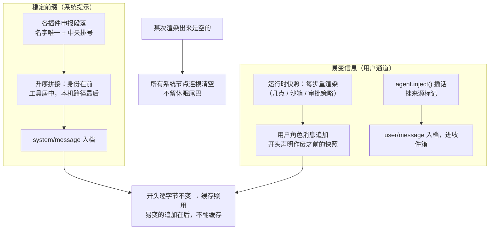

# 08 — Prompt 组装：系统提示是拼出来的

> 本课回答两个问题：模型每次看到的提示词怎么拼出来？为什么段落的顺序关系到真金白银？接缝：06 课"发车前"入档的 `system/message` 就产自这里，05 课 `system-prompt/assemble` 瀑布在这里当正主。

## 逻辑层

### 一、拼装，而不是一篇作文

**大白话**：系统提示不是一篇写死的文章，而是每家插件各自申报的**带编号的段落**：身份介绍、工具说明、计划模式规则……各报各的。拼装时按编号排队拼成一整篇。编号不由插件自己随便填，而是**全楼统一分配**——一张中央排号表。

**术语**：段落（section）= 名字唯一 + 编号 + 静态文本或现场函数；拼装按编号升序、同号按名字排序（全机器一致的字典序，不随语言环境变）；重名当场报错。

**例子**：中央排号表里，"本 harness 是谁"排最前，各工具的使用说明居中，"本机路径与端点"排在最后——设计者明说：**可复用的指令在前，本机特有的在后**。

**推论**：插件之间不吵架：名字防撞车，位置防插队。系统提示本身也是接缝思想的产物。

### 二、顺序就是钱：稳定前缀与运行时快照

**大白话**：模型厂商对一模一样的开头可以复用上次算过的中间结果（缓存）。开头越稳定、越长，越省钱越快。所以最稳定的内容排最前，越易变越靠后；那些**每一步都在变**的信息（现在几点、沙箱开没开、审批策略）根本不进系统提示——它们作为一条**用户角色的快照消息**追加进对话，开头一句"本快照作废之前所有快照"。

**术语**：缓存前缀 = 逐字节相同的开头；运行时上下文（runtime context）= 每步重新渲染的快照消息。

**例子**：07 课的审批策略变化时，新值作为新快照追加在历史之后——旧的前缀一个字没动，缓存照用。

**推论**："易变的放后面"不是排版洁癖：一个总在变的段落若混在前缀中间，每次变化都把整个缓存打翻。

### 三、空渲染清空一切

**大白话**：如果某次渲染出来是**空的**（比如部署把人格设定清空了），循环会把所有在场的系统提示节点**全部清空**——旧的指令一个字都不会留给模型。

**术语**：系统提示节点（system/message 事件）；空渲染 ⇒ 全部清空、不留"休眠"尾巴；局部变化则按节点逐个替换（都走日志，04 课的"顶替"规矩）。

**例子**：占位句的答案——空渲染之后，模型看到的旧提示是**无**，不是"看不见但还在"。

**推论**：这是安全语义：指令被撤下时必须连根撤下；"看不见但还生效"的旧指令是最危险的那种残留。

### 四、上下文工程走窄门

**大白话**：想把"有时效的信息"（当前时间、文件变更通知、技能内容、定时提醒）塞给模型，没有旁门——唯一通道是**入档**。这些信息以用户消息的身份进对话（04 课五类上镜之一），`agent.inject()` 就是挂着来源标记的这类消息。

**术语**：inject 与真实用户输入共用 user/message 通道，靠消息里的 source 字段区分来源；inject 的内容像插话一样进收件箱（05 课 steer 的下一格），运行时快照则由开跑前的默认决定并入这一步的批次（06 课认领的整批）。

**例子**：`time-context` 插件：不挂招牌、不注依赖，只守在 05 课开跑前那道闸上，每步采一次时间戳进对话。

**推论**：又一个"模型可见 ⟺ 可重建"的落点——凡是塞给模型的话，都先在档案室留了底。

两条通道、一份提示：

读法：稳定的内容从上管往下拼；每步都变的从旁边以用户身份插进来——谁也不许混进前缀中间。

### 五、三问检验：一个最小的上下文插件

拿三问读 `dsh-time-context`：**provide** 什么——无（不挂招牌）；**inject** 什么——无；**on** 什么——`agent/pre-step`（waterfall，采完时间放行）。上下文工程一族的典型长相：不做决定、只贡献一段有时效的文本。

## 记住什么 / 不用记什么

**记（4 个）**：段落拼装（编号排队、中央分配）；顺序就是钱（稳定前缀在前，运行时快照走用户消息）；空渲染清空一切；上下文工程走窄门（inject 也是入档消息）。

**不用记**（卡住回溯）：排号表的具体数字、`PromptAssembly` 等类型名、变量插值的严格规则、工具排序的占位记号、节点合并的分支细节（在 06 课引用的实现说明里）——全部是四条规则的具体实现。

## 源码层（回溯地址，不要求读）

| 想查什么 | 地址 |
|---|---|
| 中央排号表 | `packages/core/system-prompt/src/index.ts:125`（SECTION_ORDERS 及其排序注释）；运行时上下文排号 `:164` |
| 拼装瀑布 | `index.ts:31`（system-prompt/assemble；complete 段落在瀑布后原样恢复，监听者换不掉整篇） |
| 渲染 | `index.ts:279`（renderPrompt：插值、去空段、空行连接，全空返回空串） |
| 快照开场白 | `index.ts:303`（"This snapshot supersedes earlier runtime-context snapshots."） |
| 节点清空/合并语义 | `packages/core/session/src/types.ts:319`（system/message 契约）；`packages/core/agent-loop/README.md` 拼节（consolidation 规则） |
| 贯穿实例 | `packages/context/time-context/src/index.ts:185`（on agent/pre-step） |

## 自测（可选）

1. "本机路径"的段落为什么排在最后？把它挪到最前面会发生什么？
2. 部署者把人格设定清空后，模型下一轮还看得见旧人格吗？为什么"清空"比"看不见"更安全？
