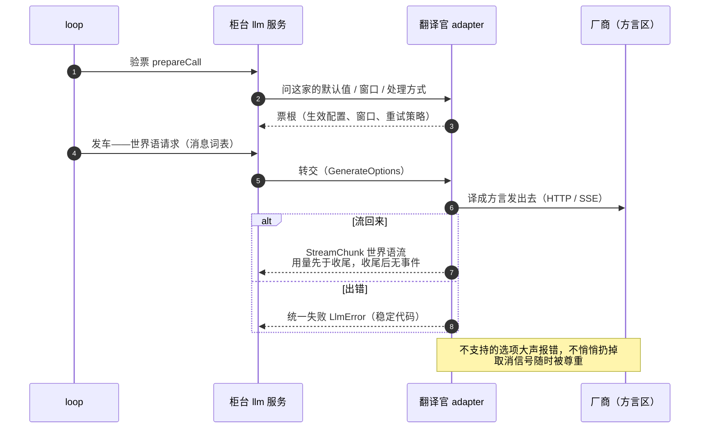

# 09 — LLM adapter：换厂商为什么不动 loop

> 本课回答一个问题：换一家模型厂商，为什么循环、日志、工具一个字都不用改？接缝：03 课"换 provider 换整个世界"的又一次兑现；06 课发车前的"验票"和发车本身，就是通往这道接缝的两扇门。

## 逻辑层

### 一、中立词表：口岸上只讲世界语

**大白话**：harness 和模型厂商之间有一个"边境口岸"。口岸内侧（循环、日志、工具）只讲两种**世界语**：进去的是**消息词表**（用户话、助手话、工具调用——参数保持模型原话），出来的是**流词表**（一段段增量：某块文字开始了、长了几个字、结束了，加上用量和收尾原因）。错误也是世界语：一律翻成带稳定代码的统一失败记录。

**术语**：进去的叫 GenerateOptions，出来的叫 StreamChunk，失败的统一叫 LlmError（超时、被取消、传输断……各有一个固定代码）。

**例子**：工具调用的参数从头到尾是原始 JSON 字符串；流式时厂商发来的是"参数增量"碎片。这条规矩写进契约，两家参考实现都按它验证过。

**推论**：口岸内侧没人需要认识任何厂商方言——方言被挡在口岸外面。

### 二、adapter 只做翻译

**大白话**：一个 adapter 就是一个翻译官，活儿只有三件：把请求**译成**厂商的线格式；把厂商的流**翻译回**世界语；把**错误翻译成**统一失败记录。翻译官内部怎么干活没人管——参考实现一家直连 HTTP 逐行读流，另一家包一个现成的 SDK，内部天差地别，对外同一份契约。

**术语**：翻译官继承一个基类，核心就一个方法：吃进请求、吐出流；注册 = `ctx.llm.registerAdapter(['厂商名'], 实例)`——01 课的老规矩：注册是 effect，随插件卸载，一夫一妻（一个厂商路线一个翻译官，重复登记当场报错）。

**例子**：契约连细节都管：用量必须在收尾之前发、收尾之后什么都不许发——因为 04 课规定用量跟着助手消息一起入档，顺序错了档案就乱。

**推论**：换厂商 = 换一个翻译官。柜台（llm 服务）不动，08 课的排号表不动，06 课的状态机不动。

### 三、验票据根：loop 只认票根，不认厂商名

**大白话**：06 课说发车前先"验票"。验票台上，翻译官把厂商规定的默认值（推理力度、最大输出）当场定下来，报告这家模型的窗口大小，声明自己怎么处理系统提示和工具增补——这些答案打成一张**票根**，跟请求一起走。loop 后面遇到的一切"这家厂商行不行"的问题，都看票根，不看厂商名字。

**术语**：验票叫 prepareCall，票根上写着：生效配置、哪些字段是厂商代定的默认、上下文窗口、系统提示的处理方式（追加进历史还是每次整发）、重试策略。

**例子**：08 课说有的路由把系统提示"追加进历史"，有的每次整发——这个差别就是票根上的一个字段，不是 loop 里的 if。

**推论**：loop 对厂商能力的全部了解来自票根。厂商升级出了新能力，改的是翻译官和票根，loop 照旧。

### 四、换厂商的完整清单

**大白话**：占位句的准话——换 provider 不改 loop，前提是翻译官满足那份**契约**：进出都翻译、错误只走两条规定路径（要么抛统一失败、要么在流里以失败收尾）、尊重取消信号、不支持的选项**大声报错**而不是悄悄扔掉、厂商私有的续传凭据压成最小的无损投影随档走。

**例子**：翻译官收到一个自己厂商不支持的"停止词列表"，契约要求它报"不支持此选项"，而不是装作没看见——悄悄扔掉等于请求和档案说的不一样。

**推论**：不变量④的字面兑现——Definition（llm 服务与两份词表）不含任何一家厂商的私有物，所以 Provider 想换就换。

一次调用过口岸的全程：

读法：口岸内侧只出现世界语和票根字段——"换厂商"就是换一名翻译官，柜台、排号表、状态机全员不动。

### 五、三问检验：翻译官本人

拿三问读 `llm-deepseek` 的接线层：**provide** 什么——无（它不挂新招牌，把自己的翻译官登记进 `ctx.llm` 的名册，占住一条厂商路线）；**inject** 什么——`['llm']`（名册所在的招牌）；**on** 什么——基本无，只跟着配置热更新同步一次重试策略。它是最纯粹的 Provider：名字不上 ctx，只在名册里占一行。

## 记住什么 / 不用记什么

**记（4 个）**：中立词表（消息 + 流，错误统一成带码失败）；adapter 只做翻译（注册是 effect、一夫一妻）；prepareCall 票根（loop 只认票根不认厂商名）；Definition 不含厂商私有物（所以 Provider 随便换）。

**不用记**（卡住回溯）：StreamChunk 的分片类型名、块编号规则、续传投影（replayState）的细节、SSE 解析、序列化与翻译的文件分工、重试策略的配置形状——全部是契约的具体落实。

## 源码层（回溯地址，不要求读）

| 想查什么 | 地址 |
|---|---|
| 契约全文（协议义务清单） | `docs/cookbook/adding-an-llm-adapter.md` |
| 翻译官基类与注册 | `packages/llm/llm/src/index.ts:204` 起（类契约）、`:396`（registerAdapter：effect、重复报错） |
| 验票两层 | `index.ts:278`（翻译官侧默认实现）；loop 侧包装见 06 课 `agent.ts:547` |
| 流词表契约 | `packages/llm/llm/src/types.ts`（StreamChunk JSDoc——cookbook 指定先读它） |
| 参考实现对照 | `packages/llm/llm-deepseek/src/adapter.ts`（直连 HTTP；`:147` 把厂商流翻译回世界语）vs `packages/llm/llm-pi-ai/src/adapter.ts`（包现成 SDK） |
| 计费去向 | `docs/subsystems/token-meter.md`（用量先于收尾的消费方） |

## 自测（可选）

1. 某厂商的 SDK 总在流结束后才补发用量。按契约翻译官该怎么处理？为什么？（联系 04 课档案。）
2. loop 的代码里找不到一行"如果是某厂商就……"。它对厂商的全部了解来自哪里？这份了解存在日志的哪个事件里？
