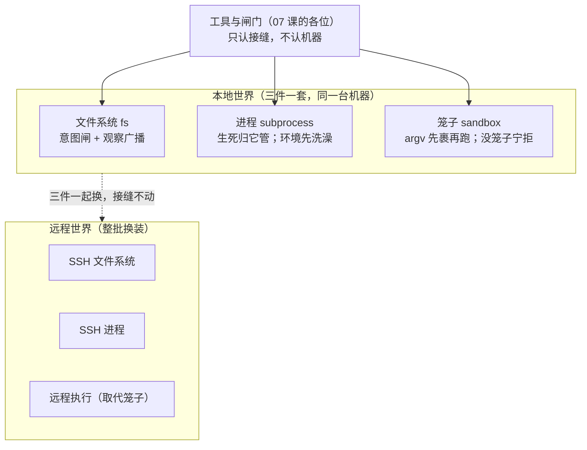

# 10 — 执行世界：工具怎么安全地碰真机器

> 本课回答两个问题：工具怎么安全地在真实机器上读写文件、起进程？指向远程机器时，为什么工具一行不用改？接缝：07 课闸门放行的调用，真正"动手"发生在本课；03 课的接缝与 09 课的换装逻辑，在这里换上一台真机器。

## 逻辑层

### 一、一个"执行世界"：三件套必须配对

**大白话**：工具干的每件事，要么动文件、要么起进程。harness 把"agent 能碰的那台机器"抽象成一个**执行世界**。世界里三样东西必须成套：**文件系统**（动文件的规矩）、**进程**（起停和生死）、**笼子**（把进程关起来）——三张招牌描述的必须是**同一台机器**：bash 进程读写的路径，和文件工具读写的路径，得是同一个世界里的同一批文件。

**术语**：执行世界（execution world）；fs + subprocess + sandbox 成套换装；bash（shell）与终端（PTY）骑在 subprocess 上面——进程的生死归 subprocess 管，所以换个 bash 执行器，已经跑着的进程照旧活着。

**例子**：subprocess 的契约原话："可执行文件路径与挂载的文件系统同属一个执行世界。"

**推论**：配对不是巧合，是承诺。拆开混搭（甲的文件系统配乙的进程）会让工具和进程活在两个世界，路径对不上。

### 二、argv 先包装后执行：笼子不监视，笼子是外壳

**大白话**：要在笼子里跑一条命令，harness 不是"放它出去跑、派人在旁边盯着"，而是**先把命令裹一层再开跑**：你想跑 `ls -la`，实际起的是"笼子程序 + 规则 + 你的 ls -la"。命令从出生那一刻就在笼子里，自己都不知道。

**术语**：包装叫 confine——交进原始 argv 和策略，还回**包好的 argv**；Linux 有两代笼子（bubblewrap / Landlock），macOS 有 Seatbelt，Windows 有受限令牌。策略按**每次调用**携带：同一瞬间，bash 可以被关成只读，而一个子 agent 的进程获准写自己的状态目录。

**例子**：这台机器上一个能用的笼子都没有？那就**拒绝开跑**——报"笼子不可用"，绝不裸奔。静默放行被契约明文禁止。

**推论**：强制发生在"起进程"这个做决定的操作里——不变量⑤的又一次落地，和 07 课"拒绝必须在闸上"同一个道理。

### 三、动文件前的小闸：第一个亮意图的说了算

**大白话**：文件这边也有一道小闸。写或改一个文件之前先过"意图闸"：瀑布上**第一个**亮出意图的监听者独占决定这一次怎么写（比如"必须先读过才能改"）；没人亮，就按默认无条件写。动手之后还有广播：谁被看过、谁被改过，喊一嗓子让观察者记账。

**术语**：`fs/write-intent` / `fs/edit-intent`（单槽瀑布——与 07 课层层表态的工具闸不同，这里第一个返回者独占，不做叠加）；`fs/observed`（通知，观察者必须同步记账）。

**例子**：观察策略插件靠 `fs/observed` 记下"模型看过哪些文件"，后来文件变了才好提醒"你看过的版本已过期"。

**推论**：策略不在工具里、也不在文件系统里，而在"动手前"的闸上——07 课同款选址：强制要发生在做决定的操作里。

### 四、远程 = 整个世界换装，工具一行不改

**大白话**：想让 agent 去远程机器干活，不是给每个工具写"远程版"，而是把世界三件套**整批换成远程实现**：文件、进程、笼子三块招牌背后，站着的全换成走 SSH 的实现。文件工具、bash、终端说话的方式一点没变。

**术语**：sandbox 契约原话："容器、微型虚拟机、远程执行，替换的是**周边的接缝**本身"——笼子服务只管同一台机器内。

**例子**：占位句的准话——指向远程 sandbox 时 Bash/PTY/LSP 一起搬走且无需为每个工具分叉，因为工具只认接缝（Definition），世界换装对它们透明（03 课与 09 课的同款逻辑，这次是字面意义的"换整个世界"）。

**推论**：多写的只有世界本身的 Provider，零散的能力（工具、闸门、提示段落）全部复用。

上面的各位与两台机器的关系：

读法：上层只认识三条接缝；两个世界内部长什么样，上层一个字都不用知道——换世界是整批换，不是逐个改。

### 五、三问检验与一次"洗澡"

shell 三件套的三问（承接 03 课的例子往下问）：**dsh-shell** provide `ctx.shell`（抽象契约，一个前台一份实现，重复加载报错）、**bash-local** 等 provide 实现、**tool-bash** 是纯消费者。加一问"进程的生死归谁"——归 `ctx.subprocess`：执行器卸载不停进程，统一由 subprocess 服务收尸。另一个值得记住的细节：起任何子进程前，环境变量先**洗一遍**——名字像钥匙、密码、令牌的一律不外传，真要传必须显式声明。默认安全，例外留门。

## 记住什么 / 不用记什么

**记（4 个）**：执行世界三件套配对（fs + subprocess + sandbox 同一台机器）；argv 先包装后执行（笼子是外壳不是监工；没笼子宁可不动手）；意图闸（第一个亮意图者独占）；远程 = 整个世界换装（工具一行不改）。

**不用记**（卡住回溯）：各模式的枚举名、拒绝对应的报错暗号（不同笼子方言不同）、环境变量清洗的正则、终端分配的细节、具体包名（bwrap/Landlock/Seatbelt 记不住没关系，知道"每台机器有自己的笼子实现"即可）。

## 源码层（回溯地址，不要求读）

| 想查什么 | 地址 |
|---|---|
| 笼子契约 | `packages/sandbox/sandbox/src/index.ts`：`confine` :177（包 argv）、fail-closed :125（拒裸奔）、策略按次携带 :70 |
| bash 契约 | `packages/shell/shell/src/index.ts`：resolve/execute 分离 :84、:93（请求/规格分离是全仓模板）；进程归属注释 :60-62 |
| 进程契约 | `packages/subprocess/subprocess/src/index.ts`：同一执行世界 :95、环境清洗 :47-80、收尸 :109 |
| 文件契约 | `packages/fs/fs/src/index.ts`：意图闸 :59、:67、观察广播 :77 |
| 远程换装 | sandbox Definition 头注（"remote execution replaces the surrounding seam"）；`packages/ssh/*` 成套 provider |
| 能力总表 | `docs/capability-seams.md`（fs / shell / subprocess / sandbox / terminal 各行三角色） |

## 自测（可选）

1. 为什么笼子选"包裹 argv"而不是"跑起来之后盯着它"？说出至少一条理由。
2. 把本地的 `bash-local` 换成远程实现时，07 课的三道工具闸、08 课的提示段落需要改吗？为什么？
