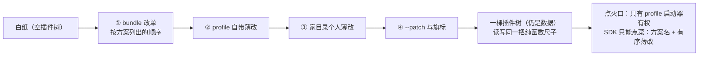

# 12 — 应用外壳：一棵插件树，三种长相

> 本课回答：同一棵插件树怎么长出 CLI、网页、SDK 三种形态？各层配置怎么叠加？接缝：02 课学的 patch 纯函数在这里正式登场——整棵树就是它叠出来的；06 课"请求从日志现算"在传输面上变成"界面从事件流渲染"。

## 逻辑层

### 一、Profile：一份拎包入住的组合单

**大白话**：dsh 出租的不是"一个程序"，而是**一栋空楼加几份标准装修方案**（profile）。每份方案是一张组合单：按顺序列出一摞**标准装修包**（bundle），再留一层你自己改的薄页。装修包本身不写新代码，里面只有一份"改单"。

**术语**：profile 是 `~/.dsh/profiles/<名字>/` 下的一个目录：一份 package.json（外部插件依赖 + 有序的 bundles 清单）+ 一份自己的 `cordis.patch.yml`；bundle = 声明了改单文件的普通 npm 包。四个官方形态（headless / web / sdk / acp）各是一份方案。

**例子**：`packages/bundle/base` 与四个 app bundle——每家贡献的就是一份有序改单。

**推论**：02 课"配置行即数据"的极致：到了应用层，整棵插件树仍然只是数据，没有任何启动代码。

### 二、四层叠加，后来者居上

**大白话**：从一张白纸开始叠：先按方案列出的顺序贴每个装修包的改单，再贴方案自带的薄页，再贴你在家目录里的个人改单（`~/.dsh/cordis.patch.yml`），最后才轮到命令行 `--patch` 和各旗标派生的小改。**越是后贴的越能改前面的**——你一行 `--patch` 能改掉一切。

**术语**：层序 bundle → profile patch → home patch → `--patch`（02 课"patch 靠 id 定位、层叠有序、后来者居上"的正式登场）；组合用的正是 02 课那个纯函数——boot 装树和 dump 出配置是**同一把尺子**，所以"打出来的配置"就是"要载的树"。

**例子**：`--dump-config` 的每一行都能说出"我来自哪一层"。

**推论**：配置的透明与可追溯不是靠文档承诺，是靠"读写共用一个纯函数"这个结构。

### 三、发射白名单：SDK 为什么只能点菜

**大白话**：楼里有条硬规定：只有 dsh 的 profile 启动器有权"点火"受支持的 Node 应用。包自带的 bin、演示脚本、SDK 的旁门——统统没有点火权。所以 SDK 拿到的菜单是：**选一份方案名 + 递几张有序薄改**，仅此而已。

**术语**：application launch 白名单（根 AGENTS.md 规则）；SDK 客户端启动的就是 `dsh --profile <名> --patch …`。

**例子**：占位句的准话——SDK 只能选 profile 而不能自带一棵插件树，因为 profile 是**被审查过、被测试过、可支持**的表面；放外部调用者自带一棵树，等于绕过部署方的审查与策略，白名单形同虚设。

**推论**：外部集成方真正要的"观察与控制"，SDK 早就给足了——见下一节。

四层叠出来一棵树：

读法：越靠后越有权，一行 `--patch` 能改掉一切；读出来的树和载入的树是同一把尺子叠的，所以 dump 的每一行都说得清自己来自哪层。

### 四、界面是事件的读者

**大白话**：网页、桌面、SDK 看到的对话画面，不是它们自己另存的一份账，而是从 04 课那条事件广播**读出来画的**。同一份日志重放，画面原样复原。

**术语**：client / host 从 `session/event` 渲染；SDK 把事件流翻译成 JSON-RPC 推给外部进程——对话事件、忙闲状态、分身完成各是一条消息。

**例子**：05 课的结论"要重放稿件就消费 session/event"，在产品层兑现成了三种形态的同一个读法。

**推论**：不变量③的第三次"消费"：因为一切可从日志重建，界面、回放、外部观察者天然共享同一份真相。

### 五、三问检验：SDK 接线员

拿三问读 `dsh-sdk/server`：**provide** 什么——stdio 上的 JSON-RPC 服务（sdk profile 的"正门"）；**inject** 什么——`['agents']`；**on** 什么——`session/event`、`agent/status`、`session/created`、`subagent/end`。它不生产任何事实，只把楼内广播翻译给楼外的进程。

## 记住什么 / 不用记什么

**记（4 个）**：profile = 有序 bundles + 薄改（树仍是数据）；层序 bundle → profile patch → home patch → `--patch`（后来者居上，读写同一把尺子）；发射白名单（SDK 只能选方案不能自带树）；界面从事件流渲染（三种形态一个读法）。

**不用记**（卡住回溯）：profile 目录里的文件名、两锚点模块解析的细节、跳过包（skippedBundles）的兼容机制、JSON-RPC 消息名、Python SDK 的差异——全部是四条规则的具体实现。

## 源码层（回溯地址，不要求读）

| 想查什么 | 地址 |
|---|---|
| 层序与两锚点解析 | `packages/boot/app-boot/src/profile.ts:1-22`（模块头注即全文纲要）；`composeEntries` :710（与 boot include 同一把尺子） |
| 各层文件 | profile 薄改 `:40`；home 薄改 `packages/boot/app-boot/src/index.ts:4`（`~/.dsh`）；CLI 叠加 `profile-context.ts:26` |
| 白名单规则 | 根 `AGENTS.md`（Application launch 节） |
| SDK 形态 | `packages/sdk/README.md`（"launches dsh with a named profile and ordered patches"）；`packages/sdk/client/src/launch.ts:132-150`（点菜方式） |
| SDK 接线员 | `packages/sdk/server/src/index.ts:22`（inject）、`server.ts:95-111`（四条广播） |
| 改单实例 | `packages/bundle/base/cordis.patch.yml` 与四个 app bundle 的同款文件 |

## 自测（可选）

1. 想临时把某个工具从 `web` 方案里去掉做一次试验：应该动哪一层？为什么不动 bundle？
2. 一个外部程序想在自己的界面里展示对话——它需要"进楼"吗？说出它最少需要连接到什么、监听什么。
