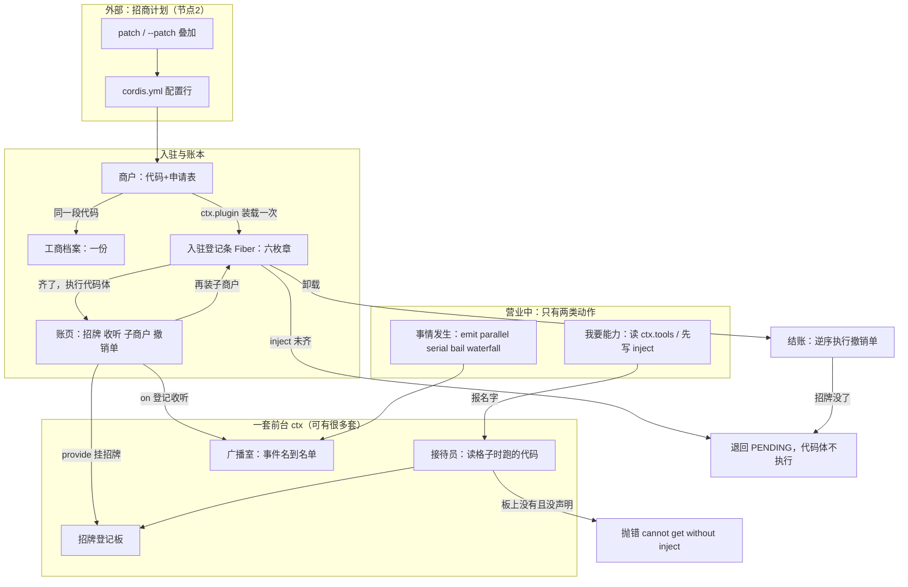

你说得对，而且指出了一个具体缺陷：我一直在**逐场景**画图、并混用术语和比喻却没给对照表。先补上这两样，再深入。我把主表 + 整体图 + 一条贯穿全程的故事线落成文件，避免又变成碎片。

你的判断**对了一大半**，先把边界画准：

- **对的部分**：Cordis 确实只做一件事——让「一段代码」在「合适的时机」拿到「它报名字要的东西」，并在「事情发生时」按规矩被通知到。整个系统就是一个**入驻 / 登记 / 播报**的调度层。
- **要补的部分**：Cordis 里**没有** agent 循环、没有会话日志、没有工具、没有模型调用。那些全住在它上面，对 Cordis 来说只是「普通的商户」。你读 `vendor/cordis/src/` 六个文件，一行产品逻辑都找不到——这不是遗漏，是它的设计目标。

下面是整套术语的对齐表，已落盘在 [lessons/01-system-map.md](lessons/01-system-map.md)（那张表带「在哪个文件第几行」这一列）。**以后所有新词都加进这张表，不再另起比喻。**

---

## 一、整座系统只有一个比喻：一栋写字楼

Cordis = **物业系统**。插件不是「组件」，是**入驻的商户**；能力不是「对象」，是商户**挂出的招牌**；事件不是「回调」，是**楼内广播和会签单**。

### 前台层（你唯一直接接触的东西）

| 真名 | 比喻 | 是什么 |
|---|---|---|
| `Context` / `ctx` | **一套前台** | 插件眼中的那个对象：给名字→给能力；喊一声→通知人 |
| Proxy handler | **接待员本人** | 「读格子时跑的代码」，决定给不给你答案 |
| `ReflectService` + `Impl` | **招牌登记板** | 一张全局表：名字 → 对象 → 谁提供的 |
| `ctx.get('x')` | **问一句「现在有 x 吗」** | 没有就返回 undefined，**不排队等** |

### 入驻层（一段代码怎么变成一家店）

| 真名 | 比喻 | 是什么 |
|---|---|---|
| `Plugin`（三种长相） | **一个商户** | 能力代码 + 随身的开业资料 |
| `name`/`Config`/`inject`/`provide`/`intercept` | **开业申请表** | 五个字段，决定你何时能开业、挂什么招牌 |
| `Plugin.Runtime` | **工商档案** | 按代码身份去重，一个商户一份 |
| `Fiber` | **一次入驻登记条** | 这一次装载的账本（状态、配置、招牌、收听、撤销单） |
| `FiberState` 六枚章 | **入驻进度章** | PENDING / LOADING / ACTIVE / FAILED / UNLOADING / DISPOSED |
| `Config`（schemastery） | **装修规格说明书** | 装载前校验，不合法直接盖 FAILED |
| root fiber（uid=0） | **大堂本身** | 最早那张登记条，四个内置服务挂它名下 |

### 记账层（为什么卸载不泄漏）

| 真名 | 比喻 | 是什么 |
|---|---|---|
| `ctx.effect(fn, label)` | **在登记条记一笔，领一张撤销单** | 立刻执行；返回的撤销函数收进本账 |
| `_disposables` + `EffectMeta` | **登记条背面的账页** | 谁挂的招牌、谁听的广播、谁开的子商户，全在这一页，可列成树 |
| `dispose` | **结账** | 逆序执行撤销单：擦招牌、划名单、停子商户 |
| `CordisError('INACTIVE_EFFECT')` | **拿已注销的登记条再记账** | 唯一 Cordis 自己抛的业务错 |

### 播报层（事情发生时怎么通知）

| 真名 | 比喻 | 是什么 |
|---|---|---|
| `EventsService` | **楼内广播室** | 全局一份「事件名 → 收听者列表」 |
| `_hooks` | **每张喇叭下面的一列名单** | 名单归广播室所有，不归 fiber |
| `Hook { ctx, callback, prepend, global }` | **名单上的一行** | 存「登记人身在哪套前台」，**为的是过滤谁能听到** |
| `ctx.on` / `ctx.once` | **登记收听** | 内部就是走一次 `fiber.effect`，所以自动随卸载消失 |
| 五种分派 | 贴告示 / 同时问完再走 / 按序问等回复 / 按序问不等回复 / **会签单** | 由三问决定：等不等、要不要答案、谁能否决我 |
| `next` | **会签单上的「转下家」这一栏** | 不填它，后面的家和内置行为全不发生 |
| `isBailed(v)` | **算不算表态** | 不是 null / false / undefined 就算 |
| `internal/*` 频道 | **物业内部频道** | 框架自己也用广播运转：装载、状态、配置求解、读写拦截 |

### 分包层（一套楼怎么变成很多套前台）

| 真名 | 比喻 | 是什么 |
|---|---|---|
| `ctx.extend(meta)` | **同层隔出一套自己的门禁** | 新前台，遮蔽但不改老前台 |
| `ctx.isolate(name, label)` | **给某块招牌单独立门牌** | 同 label 共享一个作用域 |
| `ctx.intercept(name, config)` | **给某家招牌追加一条附加条款** | 影响该服务后续装载时的配置 |
| `Service[symbols.filter]` | **这块招牌在这套门禁里算不算数** | 比较 isolate label，决定命中哪个实例 |
| dsh `Scope` | **给某个客户单独开一套前台** | 把上面三个包成「每个 agent 一套注册」——节点 3 |

### 楼外的两格（不是 Cordis 的东西）

`cordis.yml` / Loader / patch / HMR = **招商计划与它的热调整**（节点 2）；多层 profile / `--patch` = **总管理处逐级下发的招商补丁**（节点 12）。

---

## 二、整体图（就一张）

读法：**左上是「楼怎么定下来的」，中间是「一家店进来会发生什么」，右下是「店营业时只有两类动作」，最下面是「店走了会发生什么」。** 你之前所有零碎问题——为什么要 `inject`、fiber 是什么、`next` 不调会怎样、环依赖为什么静默——分别落在这四段里的同一处。

---

## 三、一条故事线，把上面全部串一遍

场景：一次工具调用被审批拦下，随后你改了配置。

1. **招商计划**（`cordis.yml`）里有一行 tools 商户，Loader 读出它，调 `ctx.plugin(...)`。
2. 用**代码身份**查**工商档案**：这家店开过了就复用档案，但**新建一张入驻登记条**（Fiber）。
3. 新登记条先过**申请表**：**规格说明书**校验配置，不合法当场盖 FAILED。
4. 申请表写着 `inject: ['llm']`。**接待员**去**登记板**查 `llm`——没有。于是这家店停在 **PENDING，代码体一行都没执行**。这就是「没有加载顺序，只有需求是否满足」。
5. 提供 `llm` 招牌的那家店结了业、登记板上多了一条，**内部频道**递出状态变化 → 第 4 步那张登记条被唤醒，盖 **ACTIVE**，现在执行代码体。
6. 代码体干三件事，每件都在**账页**上留一笔 + 一张**撤销单**：挂出自己的招牌、登记收听 `tools/execute`、可能再装子商户（子登记条的撤销单挂在父登记条的账上）。
7. 用户提了一句，agent-loop **喊一声**——用 **waterfall（会签单）**，参数末尾放一个 `next`（**「转下家」这一栏**）。
8. 广播室按**名单**取出收听者；**每行名单都记得登记人身在哪套前台**，所以别的 agent 那套前台里的店，不会被这套前台的喊声打扰。
9. 审批那家先收到，它**填了转下家**；守卫那家收到，**它没填**，直接返回一个值 → 内置行为（真正执行工具）一次都没发生，`next` 后面的家也全没收到。**这就是「Waterfall 必须调 next」这条仓库铁律的物理来源。**
10. 你在网页上关掉一个插件。改的是**招商计划**，落到第 6 步那张**账页**上：dispose → UNLOADING → **按登记的反序执行撤销单**：擦招牌、划名单、注销子商户。
11. 招牌一没，第 5 步那种「唤醒」反向发生：依赖它的登记条从 ACTIVE 退回 PENDING。配置改完招牌重新挂上，它**把代码体再执行一遍**。这就是为什么「没有卸载泄漏」不需要靠人守规矩。
12. 全程每步都能写进**值班日志**；任何一步在已注销的登记条上记账，抛 **`INACTIVE_EFFECT`**。

---

## 四、接下来往哪深入

地图上还有三类**有名字的空位**（不是遗漏）：

| 空位 | 属于 |
|---|---|
| `inject` 的**对象形态**（带拦截配置）、`Config` 校验细节、TS **声明合并**为什么能让 `ctx.tools` 有类型 | 节点 1 收尾 |
| 招商计划怎么被解析、多层 patch 按什么顺序叠加 | 节点 2 |
| 第 7 步那个「内置行为」到底是谁、链在哪几处 | 节点 6、7 |

另外提醒：**上节课两道 dispatch 自检题你还没答**——(a) 给假想的 `tools/rename-display` 事件选模式，说清选完会漏什么；(b) 用三句话解释为什么演示里 `bail` 把乙短路了。

**下一句你说走哪条**：把节点 1 那三个收尾空位补完，还是直接开节点 2？